# FlowPilot — an Adaptive, Learning QoS Engine for Mixed Home-Broadband Traffic

*Tata Elxsi TELIPORT Season 4 · Problem statement: "Adaptive QoS engine for mixed home
broadband traffic"*

> **Build a software-defined network controller that learns which applications need
> bandwidth. Simulate a network with gaming, video calls, Netflix and large downloads;
> introduce congestion; show the AI controller automatically reducing latency for
> critical applications; demonstrate measured latency, packet loss and fairness
> improvements against standard scheduling.**

---

## 0. Executive summary

**What we built.** FlowPilot is a controller for the home gateway that

1. **learns which application every flow is** — game, video call, video stream, web,
   bulk download, cloud backup — from packet *timing and size patterns only* (no payload
   inspection, no port lists; works on encrypted traffic), with a gradient-boosted model
   that is **99.7 % accurate on households it has never seen** and that labelled
   **93 % of real Linux kernel flows (99.62 % of bytes) correctly without ever
   being trained on real traffic**;
2. **learns how much each one needs** — burst peaks of calls, the bitrate a video player
   settles on, whether a download could use more — and remembers it per device in
   PostgreSQL;
3. **learns the link** — tracks the ISP's true, changing capacity from one-way-delay
   probes (a heuristic controller, plus a **residual deep-Q-network agent with a safety
   shield** that is Pareto-better on held-out links);
4. **allocates bandwidth as a utility-maximisation problem** — latency-critical traffic
   first (protected but capped), then weighted proportional fairness by household intent,
   per-device fairness for downloads, no class ever starved — and programs it into the
   **real Linux kernel** (HTB + nftables + conntrack marks) every 500 ms,
   explaining every decision in plain language.

**How we proved it.** Two independent testbeds running the *same* scenarios, the same
controller code and the same metric code: a packet-level **digital twin** (CUBIC TCP,
Linux-faithful FIFO / FQ-CoDel / CAKE / HTB models) for 8 routers × 6 scenarios × 3 seeds,
and a **real-kernel Linux testbed** (network namespaces, real kernel TCP/UDP, real qdiscs,
a userspace WAN delay line) for the 4 routers its kernel supports × 6 scenarios × 2 runs.
Baselines: a standard router, classic port-based QoS, fq_codel, CAKE and CAKE + autorate.
The twin predicts the kernel's measurements closely (§7.4), so the routers the kernel
cannot run are still evaluated credibly.

**What we measured** — latency, packet loss and fairness against standard scheduling, the
three things the problem statement asks for (ranges over the six scenarios of §6;
reductions are per scenario):

| | Standard router | **FlowPilot** |
|---|---|---|
| Game RTT p99 (digital twin) | 279 – 937 ms | **40 – 100 ms** (−83 to −92 %) |
| Call one-way delay p99 (digital twin) | 272 – 921 ms | **33 – 86 ms** (−85 to −94 %) |
| Game and call seconds within SLO (digital twin) | 5 – 17 % | **85 – 100 %** |
| Interactive QoE, MOS 1-5 (digital twin) | 1.53 – 2.49 | **4.01 – 4.78** |
| Game RTT p99 (real kernel) | 277 – 952 ms | **31 – 95 ms** (−84 to −94 %) |
| Call one-way delay p99 (real kernel) | 271 – 945 ms | **26 – 88 ms** (−84 to −95 %) |
| Game and call seconds within SLO (real kernel) | 0 – 17 % | **86 – 99 %** |
| Interactive QoE, MOS 1-5 (real kernel) | 1.52 – 2.57 | **4.08 – 4.78** |
| Call packets lost (digital twin) | 0.02 – 0.11 % | **0.00 – 0.01 %** |
| Call video frames arriving too late (digital twin / real kernel) | 21 – 75 % / 26 – 85 % | **0 – 1.4 % / 0.0 – 0.2 %** |
| Netflix time rebuffering (digital twin) | up to 34 % | **0 %** |
| Fairness between devices, Jain index, 16 vs 1 connection (twin / kernel) | 0.57 / 0.56 | **0.98 / 0.95** |
| QoE fairness F across all apps (twin / kernel) | 0.23 – 0.35 / 0.23 – 0.35 | **0.71 – 0.85 / 0.70 – 0.85** |

Against the strongest open-source alternative (**CAKE + autorate**, which needs CAKE in the
kernel), FlowPilot is within 6 ms on latency when the ISP's capacity changes, keeps video
calls clean where fairness-only schedulers cannot (**33 vs 134 ms** call p99 and 0 % vs
1.8 % packet loss when the laptop on the call also syncs files; **37 vs 62 ms** under an
upload storm), streams video at up to **+32 %** higher bitrate under load, and runs on any
Linux router kernel — including the kernel of our own testbed, which has no fq_codel, CAKE
or netem. The price is paid by bulk transfers (typically ~20 % slower while interactive
traffic is active), which is the intended "lower-effort" behaviour.

**What is in the repository.** Python back-end (simulator, Linux testbed, controller,
ML/RL, FastAPI, SQLAlchemy/PostgreSQL), a React dashboard with a live **A/B mode — same
household, same congestion, standard router vs FlowPilot**, 15 automated tests, Docker
Compose, and scripts that reproduce every number in this report.

---

## Contents

1. [The problem, precisely](#1-the-problem-precisely)
2. [Research: state of the art and the gap we fill](#2-research-state-of-the-art-and-the-gap-we-fill)
3. [FlowPilot at a glance](#3-flowpilot-at-a-glance)
4. [Design in detail](#4-design-in-detail)
5. [Implementation](#5-implementation)
6. [Evaluation methodology](#6-evaluation-methodology)
7. [Results](#7-results)
8. [Demo script](#8-demo-script-5-minutes-for-the-judges)
9. [Deployment path and value](#9-deployment-path-and-value)
10. [Limitations and next steps](#10-limitations-and-what-we-would-do-next)
11. [How to run and reproduce](#11-how-to-run-and-reproduce)
12. [References](#12-references)
- [Appendix A — full simulator tables](#appendix-a--full-simulator-results)
- [Appendix B — full kernel tables](#appendix-b--full-real-kernel-results)

---

## 1. The problem, precisely

### 1.1 What a household actually experiences

It is 9 pm. A teenager plays CS2 on the console, a parent is on a Teams call on the
laptop, the smart TV streams Netflix in 4K, someone scrolls on a phone — and the desktop
PC starts a 60 GB Steam update. Within two seconds the game "lags", the call freezes and
the voice turns robotic, pages hang. The link is a perfectly ordinary 50/10 Mb/s plan and
nothing is "broken": **the network is simply queueing everyone's packets behind the
download.**

We reproduced this exactly, on real Linux, before writing any QoS code: with a standard
router, the console's ping goes from **0.1 ms idle to 189 ms average / 249 ms max** as soon
as a 4-connection download starts (CUBIC TCP, 250 ms ISP buffer). In the full scenario
the game's RTT p99 reaches 277 ms and 26 % of the call's video frames arrive too late to be shown (§7.4).

### 1.2 Why it happens: bufferbloat

The access link (DOCSIS, DSL, GPON uplink, 5G FWA) is the narrowest point. Its equipment
has large drop-tail buffers — often hundreds of milliseconds at line rate [1][2]. Loss-based
TCP (CUBIC is the Linux/Windows default) increases its sending rate until a packet is
dropped, i.e. **until that buffer is full**. Every other packet then waits behind it:

$$ \text{queueing delay} = \frac{\text{buffer occupancy}}{\text{link rate}} = \frac{1.56\ \text{MB}}{50\ \text{Mb/s}} = 250\ \text{ms}. $$

Bandwidth is not the problem — **who waits in which queue** is. A game needs ~0.3 Mb/s but
must not wait more than a few ms; a download needs as much as possible but does not care
about 50 ms.

### 1.3 Why existing fixes are not enough

| Approach | What it does well | Where it breaks in a real home |
|---|---|---|
| ISP / router default (drop-tail FIFO) | Nothing to configure | Bufferbloat: hundreds of ms under any upload or download |
| Classic "gaming QoS" (port rules) | Prioritises known game/VoIP ports | Almost everything is encrypted on port 443 (Netflix, Steam, web, backups look identical); fixed shaper rate; port lists go stale |
| SQM fq_codel / CAKE [3][4] | Excellent latency on a *stable* link; per-flow / per-host fairness | (a) The shaper rate is static: when the ISP's capacity drops (evening congestion, FWA radio), the queue moves back into the ISP and latency explodes (we measure 600-1 100 ms at the 99th percentile). (b) It is *application-blind*: fairness is not intent — a call and a backup on the same laptop share equally; a 16-connection download beats a 1-connection 4K stream under per-flow fairness. (c) CAKE is missing from many vendor CPE kernels (and from the kernel of our own testbed VM). (d) No visibility or explanations for the user or the ISP. |
| cake-autorate [5] | Tracks capacity from delay | Fixes (a) only |
| L4S / NQB / Low-Latency DOCSIS [6][7][8] | Sub-ms queueing for marked traffic | Needs end-to-end support and application marking (DSCP 45); most home traffic is unmarked today |

### 1.4 Requirements we derived

| # | Requirement | How we measure it |
|---|---|---|
| R1 | Keep latency-critical apps near their base RTT under any load: game added RTT p95 ≤ 30 ms, call added OWD p95 ≤ 50 ms | p50/p95/p99 latency, % of seconds within SLO |
| R2 | Learn which application each flow belongs to **without DPI** (encrypted, port-agnostic) | classifier accuracy on unseen households and on real-kernel flows |
| R3 | Learn how much each application needs (demand), not just its type | allocation vs demand, streaming bitrate, call video bitrate |
| R4 | Track the link's true capacity as it changes | latency during capacity drops, utilisation |
| R5 | Allocate by *household intent* (gaming / WFH / movie night) while never starving anyone | weights, floors; bulk throughput; Jain / QoE fairness |
| R6 | Explain every decision | plain-language decision log, dashboard, database |
| R7 | Deployable on commodity Linux CPE (RDK-B, OpenWrt, prplOS): no exotic kernel features | data plane uses HTB + FIFO + nftables + conntrack only |
| R8 | Prove it against standard scheduling, on real Linux, reproducibly | same scenarios in a simulator and a real-kernel testbed; scripts reproduce every number |

---

## 2. Research: state of the art and the gap we fill

**Bufferbloat and AQM.** Gettys & Nichols named the problem and showed multi-second
latencies in home connections [1][2]. CoDel (RFC 8289) keeps the *standing* queue near a
5 ms target by dropping at an increasing rate once the minimum sojourn time stays above
target for 100 ms; FQ-CoDel (RFC 8290) adds flow queueing with a sparse-flow boost and is
the Linux default. OpenWrt's SQM wraps it with a shaper set to ~85-95 % of the measured line
rate so that the router, not the modem, becomes the bottleneck [9]. CAKE integrates
shaping, per-host and per-flow fairness, DiffServ tins and ACK filtering into one qdisc [4].

**Capacity tracking.** cake-autorate adjusts CAKE's shaper from one-way-delay deltas to
public reflectors for variable links (LTE, Starlink) [5]: cut on bufferbloat, raise under
load when delay is low. Our heuristic autorate follows the same principle; our RL agent
learns a better control law on top of it.

**Low-latency architectures.** L4S (RFC 9330) and the DualQ Coupled AQM (RFC 9332) give
scalable congestion controls sub-millisecond queues [6][7]; the NQB PHB (RFC 9956, DSCP 45,
May 2026) gives smooth, low-rate traffic a separate shallow queue and requires *traffic
protection* against misuse [8]. FlowPilot marks its real-time class DSCP 45 and implements
traffic protection, so it composes with NQB-aware networks; but it does not *require* end
points to mark anything, because today almost nothing does.

**DiffServ and Wi-Fi.** RFC 4594 defines service classes [10]; RFC 8622 the Lower-Effort
PHB for background traffic [11]; RFC 8325 maps DSCP to Wi-Fi WMM access categories [12].
FlowPilot's five classes follow this taxonomy and write the corresponding DSCP on egress,
so the Wi-Fi hop (often the next bottleneck) honours the same priorities.

**Classifying encrypted traffic.** Port-based classification is obsolete; payload
inspection is impossible under TLS 1.3/QUIC and undesirable for privacy. Surveys show that
flow statistics — packet sizes, inter-arrival times, direction, burstiness — classify
encrypted traffic with >95 % accuracy using classical ML [13][14][15]. We use exactly these
features, computed on the router, and add *early* classification (from 0.5 s) and online
hysteresis.

**Learning-based network control.** Pensieve showed RL can learn better video ABR than
hand-tuned rules [16]; DRL has been applied to SDN QoS and bandwidth allocation [17][18].
Two lessons shape our design: (1) learn where the hand-written controller is weakest
(capacity tracking on variable links), not everything at once; (2) deploy learned
policies inside guarantees — *residual* policies that refine a sound controller [19] and
*shields* that veto unsafe actions [20].

**QoE.** Voice: ITU-T G.107 E-model (R → MOS) [21] with G.114's 150/400 ms one-way delay
planning limits [22]. Gaming: latency below 100 ms already degrades FPS players' accuracy
[23]; G.1072 models gaming QoE. Video: buffering ratio dominates engagement (1 % more
buffering → >3 minutes less viewing per 90-minute event) [24]; P.1203 / QoE_lin combine
bitrate, stalls and switches [16]. Web: G.1030 maps page-load time to MOS logarithmically.
Fairness: Jain's index [25] and the QoE fairness index of Hoßfeld et al. [26].

**Industry context.** Tata Elxsi integrated RDK-B with Qualcomm's 5G FWA platform,
explicitly offering QoS to operators [27]; the Broadband Forum's TR-181 data model and
TR-369 (USP) are how operators manage such gateways [28]. FlowPilot is designed to live in
exactly that stack (§9).

**The gap.** No deployed approach simultaneously (a) keeps latency low, (b) follows a
varying capacity, (c) knows *which application* each flow is and *what it needs*, (d)
allocates by household intent, (e) explains itself, and (f) runs on a plain HTB kernel.

| | low latency | follows capacity | app-aware | intent | explains | plain-HTB kernel |
|---|---|---|---|---|---|---|
| FIFO | | | | | | ✓ |
| Static QoS | partly | | ports only | | | ✓ |
| fq_codel / CAKE | ✓ | | | | | (needs the qdisc) |
| CAKE + autorate | ✓ | ✓ | | | | (needs CAKE) |
| **FlowPilot** | ✓ | ✓ | ✓ (ML) | ✓ | ✓ | ✓ |

---

## 3. FlowPilot at a glance

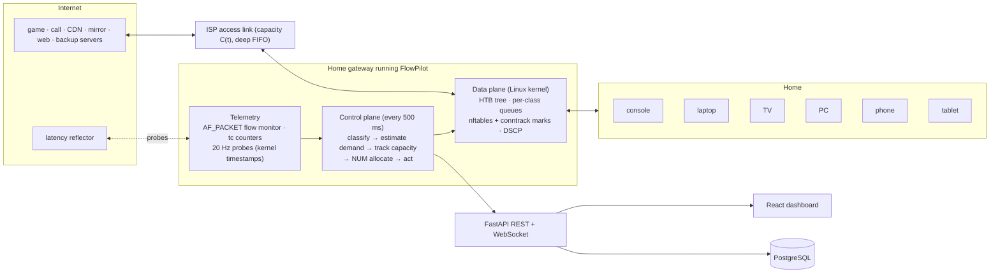

Every 500 ms the controller closes this loop:

1. **Observe** — per-flow byte counters and behavioural features (router-side flow
   monitor), per-class queue statistics (`tc -s -j`), one-way delays from probes.
2. **Classify** — the ML model labels each flow (gaming, video call, streaming, web, bulk,
   upload) with a confidence; labels change only after two consistent confident votes.
3. **Estimate demand** — per class: offered load, 100 ms burst peaks for real-time media,
   saturation for elastic traffic, learned average bitrate for video streams.
4. **Track capacity** — every 200 ms the autorate (heuristic or RL) sets the shaper just
   below the true bottleneck so the queue stays in the router, where FlowPilot controls it.
5. **Allocate** — network-utility maximisation: inelastic latency-critical traffic first
   (protected but capped), then weighted proportional fairness among elastic classes,
   with floors so nothing starves, and per-device fairness inside "bulk".
6. **Act** — write each flow's class into its conntrack mark and push the HTB plan
   (rates, ceilings, priorities, burst sizes, buffer limits) to the kernel. Log why.

---

## 4. Design in detail

### 4.1 Traffic classes

| Class | HTB id | Applications | Borrow prio | Delay budget | DSCP written | Wi-Fi AC (RFC 8325) | Kind |
|---|---|---|---|---|---|---|---|
| Real-time | 1:10 | game state, DNS, latency probes | 0 | 5 ms | 45 (NQB) | AC_VO | inelastic |
| Conferencing | 1:20 | video calls (Teams/Zoom/Meet) | 1 | 15 ms | AF41 | AC_VI | inelastic |
| Interactive | 1:30 | web, API calls, **new unclassified flows**, pure TCP ACKs | 2 | 15 ms | CS0 | AC_BE | elastic |
| Streaming | 1:40 | buffered video (Netflix/YouTube/Prime) | 3 | 20 ms | AF31 | AC_BE | elastic |
| Bulk | 1:50 → 1:51..1:59 | downloads, updates, cloud backup — one sub-class per device | 4 | 20 ms (+BDP rule) | LE (1) | AC_BK | elastic |

New flows start in *Interactive* (benefit of the doubt, like FQ-CoDel's sparse-flow
boost) unless they **inherit** the class of sibling connections from the same device to
the same server (download managers and browsers open several) — see §4.4.5.

### 4.2 Data plane (what runs in the kernel)

```
r-lan (downlink)                         r-wan (uplink): identical tree
1:   htb default 30
└─ 1:1  rate = ceil = C_hat (autorate)
   ├─ 1:10 Real-time     rate g10  ceil min(R, 2·g10)   prio 0   leaf: short queue
   ├─ 1:20 Conferencing  rate g20  ceil min(R, 2·g20)   prio 1   burst = 40 ms of g20
   ├─ 1:30 Interactive   rate x30  ceil R               prio 2
   ├─ 1:40 Streaming     rate x40  ceil ≤ 2.5·learned bitrate     prio 3
   └─ 1:50 Bulk          rate x50  ceil R               prio 4
      └─ 1:51 … 1:59     one leaf per home device, equal share, ceil R
```

* **HTB semantics** (we model them exactly in the simulator): a class sends at its
  guaranteed `rate`, may *borrow* up to `ceil` when others leave capacity unused; spare
  capacity goes to the lowest `prio` first; within a priority, in proportion to rate.
  So guarantees are not limits — the tree is **work-conserving**: a download still gets
  the whole link when nobody else needs it.
* **Leaf queues:** `fq_codel` when the kernel has it; otherwise a `bfifo` whose byte limit
  FlowPilot rewrites every 500 ms to *drain rate × delay budget* — a time-bounded queue
  that needs no AQM support in the kernel. Our testbed kernel has no fq_codel, so every
  real-kernel result in this report uses the plain-bfifo variant.
* **Classification:** the controller writes the class id into the flow's **conntrack
  mark** (`conntrack -U … --mark 51`); one nftables rule per class copies the mark into
  `skb->priority`, which HTB uses directly as the class id, and rewrites DSCP. Both
  directions of a connection follow automatically. Fixed rules: DNS and probes → 1:10;
  pure TCP ACKs (`tcp flags == ack`, length < 120) → 1:30 so a saturated upload can never
  starve the ACK clock of downloads (a classic home-network failure).
* **Why this matters for deployment (R7):** it uses only HTB, FIFO, nftables and
  conntrack — present in every Linux CPE kernel, including RDK-B and OpenWrt builds and
  the VM kernel we tested on, which has *no* fq_codel, CAKE or netem.

### 4.3 Telemetry

* **Flow monitor** — `AF_PACKET` sockets on both router ports copy 64 bytes per packet
  (IP + transport header). Packets are counted *where they arrive* — downlink on the WAN
  port before the shaper, uplink on the LAN port before the shaper — so the monitor sees
  the *offered* load, including packets the router later drops. It runs in its own
  process (≈ 325 000 packets in 60 s at 50 Mb/s in our runs) and ships per-flow counters
  every 500 ms and feature vectors every second. Payloads are never read.
* **Queue statistics** — `tc -s -j class show`: bytes, drops and backlog per class.
* **Latency probes** — 20 Hz UDP probes from the router's WAN address to a reflector beyond
  the ISP. Both ends use **kernel receive timestamps (SO_TIMESTAMPNS)**, so one-way delays
  in both directions are exact even when the controller's event loop is busy. (An early
  version timestamped in user space and the event-loop jitter looked like "uplink
  bufferbloat" — kernel timestamps removed that artefact, §5.3.)

### 4.4 Learning which applications need bandwidth (R2, R3)

#### 4.4.1 Features: the *shape* of a flow, not its contents

Computed per direction over a 5 s sliding window of 100 ms bins (identical code in the
simulator and on the router):

| Group | Features | Why it separates applications |
|---|---|---|
| Transport | `is_udp`, `log_age_s` | games/calls are UDP; age lets the model use more evidence as it accrues |
| Rate | `log_pps_up/down`, `log_kbps_up/down`, `log_peak_kbps_down` | a game is ~64 pkt/s but only ~150 kb/s; a call is Mb/s both ways; bulk is tens of Mb/s one way |
| Size | `mean/std_size_up/down`, `frac_small_up`, `frac_large_up/down`, `frac_small_down` | game packets are small; video frames are ~1200 B; downloads are 1500 B down and 66 B ACKs up; uploads the reverse |
| Timing | `iat_cv_up/down`, `log_iat_mean_up/down_ms` | ticks and media frames are periodic (low CV); TCP is bursty |
| Burstiness | `burst_cv_up/down`, `on_frac_up/down` | video streaming is ON/OFF (segment fetch, then idle); bulk is continuous |
| Asymmetry | `log_ratio_up_down` | calls are symmetric, streaming/bulk downlink-heavy, backups uplink-heavy |
| Context | `log_host_flows`, `log_host_same_dst` | download managers open many parallel connections to one server |

Port numbers are deliberately **not** features: everything interesting runs on 443.

#### 4.4.2 Data: 400 randomised households

`python -m flowpilot.ml.dataset` simulates 400 households, each with a random link
(8-300 Mb/s, asymmetric ratios, 30-600 ms ISP buffers, 2-90 ms path delays), a random
router (FIFO with bufferbloat, fq_codel, static QoS, CAKE) and 3-9 randomised
applications: game tick rates 20-128 Hz and packet sizes, call bitrates and frame rates,
streaming ladders/segment lengths/buffer targets, 1-16 parallel connections, think times.
Features are sampled at flow ages 0.5 s … 60 s. Result: **122 664 labelled samples**
(gaming 3 990, video call 4 093, streaming 4 212, web 64 409, bulk 24 721, upload 21 239).
Randomising the generators (domain randomisation) is what makes the model transfer to
traffic it never saw — including real Linux TCP (§4.4.4).

#### 4.4.3 Model

A histogram gradient-boosted tree ensemble (scikit-learn `HistGradientBoostingClassifier`,
48 leaves, early stopping, class re-weighting). It needs no feature scaling, handles the
non-linear interactions (e.g. "UDP **and** small **and** periodic"), trains in ~11 s and
classifies 64 flows in ~6 ms on one core. Training uses a **grouped split: whole households
are held out**, so the score measures generalisation to unseen homes.

#### 4.4.4 Results

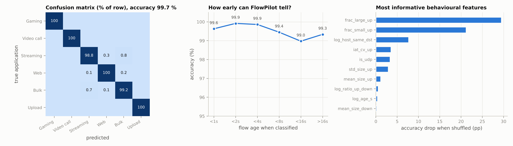

| Model | Accuracy (unseen households) | Macro-F1 |
|---|---|---|
| **Gradient-boosted trees (deployed)** | **99.66 %** | **0.993** |
| Random forest (200 trees) | 99.40 % | 0.989 |
| Expert rules (fallback) | 74.3 % | 0.719 |

* Per class: gaming, video call and upload are perfect (F1 = 1.000); web 0.998, bulk 0.992;
  streaming 0.971 — the only real confusion is a video player *filling its buffer*, which
  for a few seconds looks exactly like a download.
* **Early classification:** 99.6 % accuracy already for flows younger than 1 s.
* **Most informative features** (permutation importance): fraction of large uplink packets,
  fraction of small uplink packets, parallel connections to the same server, uplink
  inter-arrival regularity, transport protocol.
* **Sim-to-real transfer:** trained *only* on simulated traffic, the model labelled the
  flows of the real Linux testbed — real kernel CUBIC, real sockets, real timing —
  at **93 % of flows and 99.62 % of bytes** across all 24 FlowPilot kernel runs (1490/1608 flows); every miss is a web connection labelled bulk (§7.7).

#### 4.4.5 Making it robust online

* **Hysteresis** — a flow's label changes only after two consecutive predictions agree with
  ≥ 60 % confidence; the first label needs ≥ 55 %.
* **Sibling inheritance** — a new connection from a device to a server it is already
  talking to starts in the siblings' class (e.g. the 8 Steam connections, a browser's 6
  connections), instead of spending its first second in *Interactive*.
* **Traffic protection** (RFC 9956 spirit) — a flow in Real-time that exceeds 1.5 Mb/s, or
  in Conferencing beyond 12 Mb/s, for 3 control periods is moved to Bulk and the event is
  logged. A misclassified QUIC download cannot hijack the priority classes.
* **Explanations** — each decision carries a human-readable reason, e.g. *"steady 64/64
  pkt/s of small packets (98/326 B), only 210 kb/s: a game-state exchange"*.

#### 4.4.6 Learning *how much* each application needs

* **Inelastic (game, call):** guarantee = 1.3 × max(peak 0.5 s load, 0.6 × 100 ms burst
  peak) + 64 kb/s per flow, capped (Real-time ≤ 20 %, Conferencing ≤ 45 %, both ≤ 55 % of the
  link). Sizing on *100 ms* peaks matters: HTB serves classes within their guarantee before
  any borrowing class, so a video key-frame that exceeds the guarantee would otherwise wait
  behind bulk traffic. An HTB `burst` of 40 ms lets a whole key-frame leave at line rate.
* **Elastic:** a class is *saturated* if, in the last 4 s, it used ≥ 85 % of its allocation,
  queued beyond 30 % of its buffer, or dropped; then its demand is unbounded, otherwise
  1.25 × its peak.
* **Streaming:** each stream's ~20 s average rate approximates its bitrate; FlowPilot caps
  the class's burst ceiling at ≈ 2.5 × that (≥ 4 Mb/s) so a segment fetch cannot starve
  everyone else, yet the player can still step up one rung.
* **Device profiles:** every 5 s the observed (device, application, demand) is folded into
  `device_profiles` in PostgreSQL (EWMA averages and peaks) — the household's learned
  "who uses what" history shown in the dashboard.

### 4.5 Allocation as network-utility maximisation (R5)

For one direction with shaped capacity $R$ we choose class guarantees $x_k$:

$$ \max_{x}\ \sum_{k\in\text{inelastic}} w_k\,\mathbb{1}[x_k \ge d_k] \;+\; \sum_{k\in\text{elastic}} w_k \log x_k
\quad\text{s.t.}\quad \sum_k x_k \le R,\;\; f_k \le x_k \le c_k . $$

Inelastic utility is a step at the demand $d_k$ (bandwidth below it is worthless, above it
useless) [29]; elastic utility is logarithmic, whose optimum is the weighted
proportionally fair allocation [30]. With demand caps the solution is:

1. **Inelastic first:** $x_k = \min(c_k,\ d_k)$ (scaled down together if they exceed 55 % of $R$
   — logged as an admission warning).
2. **Weighted water-filling** for elastic classes on what remains,
   $x_k = \min\big(d_k,\ \max(f_k,\ w_k\lambda)\big)$ with $\lambda$ such that $\sum x_k = R_{el}$.

Floors $f_k$ (Bulk ≥ 5 %, Interactive ≥ 5 %) guarantee no starvation. Weights come from
the household **intent**:

| intent | Real-time | Conferencing | Interactive | Streaming | Bulk |
|---|---|---|---|---|---|
| balanced (default) | 8 | 8 | 4 | 4 | 1 |
| gaming | 12 | 6 | 4 | 3 | 1 |
| work_from_home | 6 | 12 | 6 | 2 | 1 |
| movie_night | 6 | 6 | 3 | 8 | 1 |

Mapping to HTB: `rate = x_k`; `ceil = R` for elastic classes (work-conserving), `ceil =
min(R, max(2 g, g + 2 Mb/s))` for inelastic ones (traffic protection); fixed borrowing
priorities (§4.1). **Buffer sizing:** classes that drain at up to their ceiling (web,
streaming) get `ceil × budget`; each device's bulk leaf gets
$\max(\text{budget},\ \text{RTT}/\sqrt{n})$ of its share, $n$ = that device's parallel
flows — the classic $BDP/\sqrt{n}$ rule [31] that lets even a *single* download connection
keep its fair share (without it, a 1-connection tablet lost to a 16-connection PC: Jain 0.92
→ 0.98 after the fix).

### 4.6 Tracking the link's capacity (R4)

Ingress (download) shaping only works if the router's shaper is slower than the true
bottleneck; if the ISP's capacity drops below the shaper, the queue silently moves back
into the ISP's deep buffer. FlowPilot's autorate (every 200 ms, per direction):

* **Signal:** one-way delay samples $o_t$; baseline $b \leftarrow b + 0.9(o-b)$ when $o<b$,
  else $b \leftarrow b + 0.001(o-b)$ (fast down, slow up); delta $\delta = o-b$, EWMA 0.3.
* **Bufferbloat** = at least 3 of the last 6 deltas above 12 ms (or probes lost for > 1 s
  under load) → cut: $R \leftarrow \max\big(R_{min},\ \min(R, a)\cdot\max(0.75,\ 0.97 - (\delta-12)/150)\big)$,
  with $a$ the throughput actually delivered — a deeper cut for a worse bloat — then a
  600 ms refractory period.
* **Probe up** when load ≥ 80 % and $\delta$ < 6 ms: ×1.04 per step, but only ×1.003 near the
  last bloat point during the first 3 s after a bloat, ×1.012 until 8 s, then full speed —
  concave-then-convex like CUBIC, so a ceiling is not hammered yet recovered capacity is
  found within seconds. (A first version without the time-decay took > 15 s to recover from
  a capacity dip; fixing it raised utilisation in the congestion scenario from 75 % to 87 %.)
* **Ceiling:** 95 % of the plan rate for fixed lines — the SQM margin [9].

### 4.7 Reinforcement learning for capacity tracking

The heuristic's constants (thresholds, step sizes) are a compromise across link types. RL
learns a state-dependent control law. We formulate:

* **State (12 features, all router-observable):** delay delta, max delta in the last
  interval, delta trend, shaper load, rate / plan, delivered rate / plan, last action, time
  since the last bloat, fraction of samples over threshold, last bloat rate / plan,
  throughput-change ratio, and the heuristic's proposed change.
* **Action — residual policy [19]:** multiply the heuristic's proposed rate by one of
  {0.80, 0.90, **1.00**, 1.05, 1.12}. "1.00" *is* the heuristic, so the agent starts from,
  and can only refine, a sound controller.
* **Reward per 200 ms:** $r = u - 0.04\,(d-5)^+ - 0.0015\,(d-30)^{+2} - 0.3\,\text{loss} - 0.01\,\text{change}$,
  clipped at −10, with $u$ the utilisation of the true capacity and $d$ the ISP queueing
  delay in ms.
* **Shield [20]:** never amplify an increase while bloated (δ > 15 ms) or idle (load < 0.3).
* **Training environment:** a vectorised **fluid model** of the access link at 10 ms
  resolution (`ml/rl/fluid.py`): capacity traces from three families (fixed line with
  congestion steps; 5G-FWA-like AR(1) log-capacity with deep fades; LTE-like regime
  switching), TCP aggregate chasing min(R, C) with overshoot and multiplicative back-off on
  buffer overflow, random burst arrivals (slow starts, segment fetches), inelastic load,
  buffer depth 80-800 ms, probe noise 0.2-3 ms. 32 environments in parallel; ~1 M
  transitions train in ~6 minutes on a laptop CPU.
* **Learner:** Double DQN, numpy MLP 12-64-64-5 (no deep-learning framework needed on a
  router), Huber loss, Adam (5e-4), replay 300 k, batch 256, soft target updates (τ =
  0.005), γ = 0.95 (≈ 4 s horizon), ε 1 → 0.03.

Results are in §7.8. A first attempt with direct multiplicative actions (no residual), and
a second with an extra "snap to delivered rate" action, were both worse than or unstable
against the heuristic; the residual formulation fixed that — a useful lesson we keep in
the report.

### 4.8 Explainability (R6)

Every action is logged with its reason; examples from real runs:

```
 1.53 classify  console: UDP flow to 203.0.113.10:27015 is Online gaming (100%) -> Real-time
10.95 classify  laptop: UDP flow to 203.0.113.11:3478 is Video call (100%) -> Conferencing
14.71 allocate  Downlink 43.3 Mb/s guaranteed: Real-time 0.4, Conferencing 4.7, Interactive 9.2,
                Streaming 21.7, Bulk 7.4 Mb/s
20.85 autorate  Bufferbloat on the downlink (+21 ms): ISP capacity fell, shaper 47.5 -> 41.3 Mb/s
33.56 classify  pc: TCP flow to 203.0.113.13:443 is Bulk download (100%) -> Bulk
```

The log streams to the dashboard and is stored in the `decisions` table.

### 4.9 Guard-rails

No class can starve (floors); inelastic classes are capped (traffic protection); labels
change only with hysteresis; the RL agent is residual + shielded and falls back to the
heuristic on out-of-range observations; the bfifo limits are rewritten only on >10 %
changes; if no trained model exists, a transparent rule set classifies (74 % accurate) and
the controller still works.

---

## 5. Implementation

### 5.1 Stack and module map

| Concern | Technology | Where |
|---|---|---|
| Digital twin | Python discrete-event simulator (≈ 400 k events/s) | `backend/flowpilot/sim` |
| Real network | Linux network namespaces, veth, bridge, TUN, HTB, TBF, bfifo, nftables, conntrack, AF_PACKET | `backend/flowpilot/testbed` |
| Controller | Python (shared by both back-ends) | `backend/flowpilot/controller` |
| ML / RL | scikit-learn, numpy | `backend/flowpilot/ml` |
| API | FastAPI, uvicorn, WebSocket | `backend/flowpilot/api` |
| Storage | PostgreSQL 16 via SQLAlchemy 2 (SQLite fallback) | `backend/flowpilot/db` |
| Dashboard | React 18, TypeScript, Vite, Recharts | `frontend/` |
| Packaging | Dockerfile, docker-compose (PostgreSQL + API, optional privileged testbed) | repo root |

The **same controller code** drives the simulator and the kernel: only two adapters differ
(`controller/sim_qos.py` and `testbed/kernel_qos.py`), and the same feature code runs in the
simulator and in the router's packet monitor.

### 5.2 The digital twin

* Event engine with a binary heap; links serialise packets at their rate and hand them to a
  pluggable qdisc.
* **TCP:** CUBIC with HyStart, slow-start restart after idle, delayed ACKs, SACK-style loss
  recovery (DupThresh 3), RFC 6298 RTO with back-off; ACKs travel through the *same*
  uplink queues — which is what makes uploads hurt downloads.
* **Qdisc models:** FIFO; FQ-CoDel per RFC 8290 (DRR++ with new/old lists, CoDel control
  law, drop-from-fattest); CAKE-style host fairness (quantum ÷ host load, as in sch_cake);
  HTB with Linux semantics (modes, lender levels, prio, DRR quantum = rate/r2q, charging
  rules) — unit-tested (`tests/test_qdisc_sim.py`).
* **Applications:** game (tick-rate UDP, in-game ping with server hold-time compensation),
  video call (audio 50 pkt/s + paced video frames with key-frames, receiver reports, GCC-like
  delay/loss rate control), streaming (Netflix-like 235 kb/s - 16 Mb/s ladder, 4 s
  segments, 30 s buffer, throughput + buffer ABR, real stalls), web (DNS-less page = TCP +
  TLS handshakes, main document, 8-30 objects over up to 6 connections), bulk download and
  upload (N parallel CUBIC flows).

### 5.3 The real-kernel Linux testbed

```
fp-inet  servers 203.0.113.10-15 + reflector .53
   │  TUN ⇄ userspace delay line (per-server one-way delay, e.g. 14.5 ms to the game server)
fp-isp   TBF 50 Mb/s down + 250 ms FIFO; TBF 10 Mb/s up + 500 ms FIFO   (the "ISP")
   │  veth
fp-router  FlowPilot / baseline qdiscs on r-lan (down) and r-wan (up), nftables, conntrack,
   │       AF_PACKET monitor, probes
fp-lan   bridge br0
   ├─ fp-dev-console 192.168.1.10   ├─ fp-dev-laptop .11   ├─ fp-dev-tv .12
   ├─ fp-dev-pc .13                 ├─ fp-dev-phone .14    └─ fp-dev-tablet .15
```

* All traffic is **real**: kernel TCP (CUBIC) and UDP sockets created inside each device's
  namespace by one asyncio process (a socket stays bound to the namespace it was created in,
  so `setns` → create → switch back), real HTB/TBF queues, real nftables and conntrack.
* **Delay line instead of netem:** the testbed VM's kernel has no `netem` (nor `fq_codel`,
  `cake`, `prio`, `sfq`). We join the Internet and ISP namespaces with two TUN devices and
  a relay process that delays each packet by its server's one-way path delay — real RTTs
  (31 ms console↔game server, 15 ms TV↔CDN) for every TCP connection.
* GSO/TSO/GRO are disabled on every veth so frames are 1500-byte packets, as on a real
  access link; CUBIC is selected in every namespace (the VM default, BBR, would hide
  bufferbloat — itself a finding worth noting: BBR-paced CDNs bloat less).
* **Kernel timestamps** (SO_TIMESTAMPNS) for every latency measurement.
* `testbed/netns.py::capabilities()` probes which qdiscs the kernel offers; schedulers that
  need missing qdiscs (fq_codel, CAKE) are skipped automatically on the kernel testbed and
  evaluated in the digital twin instead.

### 5.4 API and database

REST: `/api/capabilities`, `/api/session/start|stop|action`, `/api/runs…`,
`/api/benchmarks…`, `/api/models/classifier|rl`, `/api/profiles`; WebSocket `/ws/live`
streams one JSON tick per second (per-app metrics, per-class allocation, flow table,
decisions). Tables: `runs`, `samples` (per-second telemetry, JSONB), `decisions`, `flows`,
`device_profiles`. A background writer thread batches inserts so the control loop never
waits on the database. Benchmark result files are imported automatically on start-up.

### 5.5 Dashboard

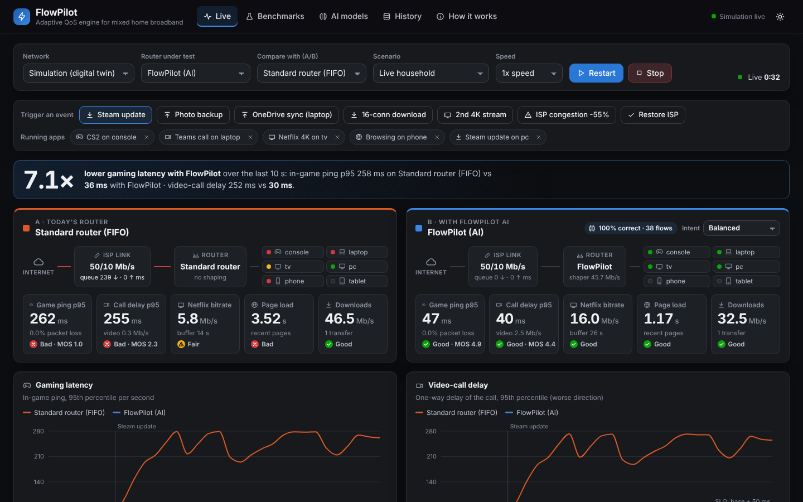

The **Live** tab runs an A/B session: the same simulated household under two routers
(default: standard FIFO vs FlowPilot), with one-click events (Steam update, photo backup,
OneDrive sync on the call laptop, 16-connection download, second 4K stream, ISP
congestion, restore) and household intents. It shows per-app KPIs and QoE colours, latency
and throughput charts, the per-class allocation, the classified flow table with confidence
and explanation, and the AI decision feed. In **Linux testbed** mode the same page drives
the real kernel. Other tabs: **Benchmarks** (all results from PostgreSQL, digital twin or
real kernel), **AI models** (classifier card, RL training/evaluation), **History** (stored
runs, learned device profiles), **How it works**.

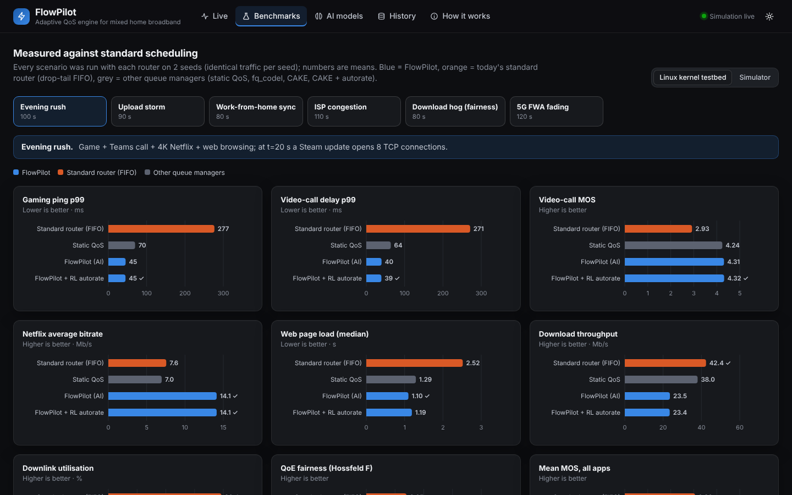

*The Benchmarks tab: every router on the same scenario, from the database (here: the real
Linux kernel results).*

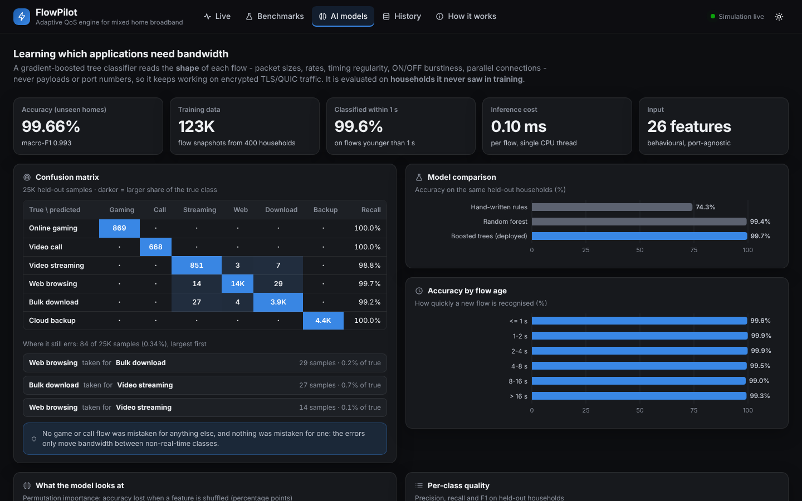

*The AI models tab: the classifier's model card — accuracy on unseen homes, confusion matrix,
where it still errs, accuracy by flow age; the RL autorate's evaluation follows below.*

| History: stored runs and learned device profiles | How it works: architecture and design notes |
|---|---|
| 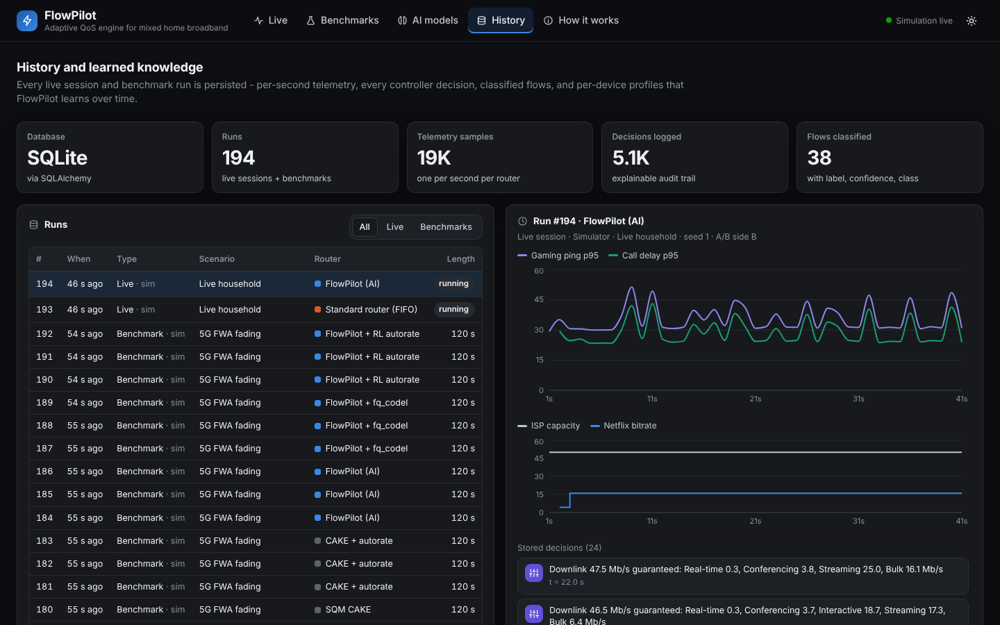 | 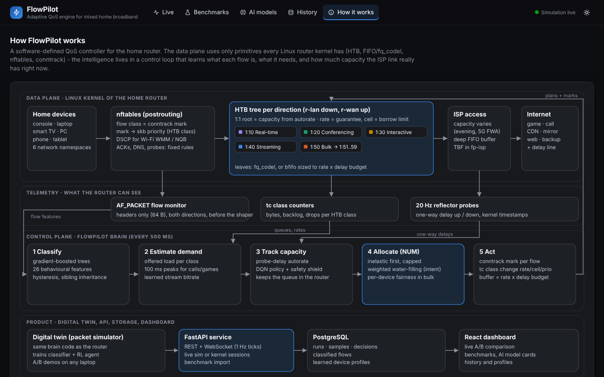 |

### 5.6 Tests

`python -m pytest -q` (15 tests): E-model reference points and fairness formulas, allocator
invariants (protection, floors, caps, work conservation), HTB rate/ceil/priority-borrowing
semantics, FQ-CoDel sparse-flow isolation, bufferbloat reproduced by FIFO and removed by
FlowPilot, trained-model recognition of simulated apps, rule fallback, a full live API
session over the WebSocket, and testbed connectivity (as root).

---

## 6. Evaluation methodology

**Questions.** Does FlowPilot (Q1) cut latency and loss for critical apps versus standard
scheduling, (Q2) stay correct when capacity changes, (Q3) improve fairness and QoE rather
than just move pain to someone else, (Q4) work on a real kernel, and (Q5) what does it cost?

**Two testbeds, same scenarios, same metric code.**

1. *Digital twin* (simulator): all eight router policies, three seeds per cell.
2. *Real Linux kernel testbed*: the policies whose qdiscs this kernel offers — FIFO,
   static QoS, FlowPilot, FlowPilot + RL (fq_codel and CAKE are absent here; on a stock
   Ubuntu/OpenWrt kernel they run on the testbed too).

**Scenarios** (household of six devices; 50/10 Mb/s unless stated; ISP buffers 250 ms down /
500 ms up at plan rate):

| Scenario | What happens | Tests |
|---|---|---|
| Evening rush | game + Teams call + 4K Netflix + web; t = 20 s Steam update (8 TCP) | Q1, classic bufferbloat |
| Upload storm | game + call + web; t = 15 s tablet photo backup (4 uploads); t = 30 s download | uplink bloat, ACK starvation |
| Work-from-home sync | the laptop on the call also syncs OneDrive (4 uploads) | same-device contention (per-host fairness cannot help) |
| ISP congestion | evening rush; capacity 50/10 → 22/6 Mb/s from 45 s to 85 s | Q2, fixed shapers |
| Download hog | 16-connection download vs 1-connection download + call + 4K stream | Q3, fairness |
| 5G FWA fading | capacity follows an AR(1) trace 15-60 Mb/s with deep fades | Q2, variable links |

**Router policies (baselines).**

| Policy | Represents |
|---|---|
| Standard router (FIFO) | most ISP CPE: no shaping, drop-tail |
| Static QoS | consumer "gaming QoS": HTB at 95 % of the plan, port rules (Xbox, Steam, Teams/STUN, Zoom, Meet, SIP, DNS), ACK priority |
| SQM fq_codel | OpenWrt SQM `simplest.qos` at 95 % of plan |
| SQM CAKE | CAKE-style per-host + per-flow fairness with CoDel at 95 % of plan |
| CAKE + autorate | CAKE with the same delay-based autorate FlowPilot uses (the strongest open-source competitor) |
| **FlowPilot** | this work; bfifo leaves (works on any kernel) |
| FlowPilot + fq leaves | FlowPilot with fq_codel leaves (when the kernel has it) |
| FlowPilot + RL | FlowPilot with the residual-DQN autorate |

**Metrics** (`backend/flowpilot/common/metrics.py`).

* Latency: game in-game RTT (server hold-time compensated), call one-way delay (both
  directions, worst reported); p50/p95/p99 over all samples; jitter (RFC 3550).
* Loss per stream from sequence numbers; **late frames** of the call: share of video frames
  that are incomplete or complete more than 250 ms after capture (seen as a freeze).
* Voice MOS: E-model, $R = 93.2 - I_d - I_{e,eff}$, mouth-to-ear = median OWD + adaptive
  jitter buffer (max(20 ms, 2.5 × jitter)) + 25 ms codec; late packets count as lost;
  penalised by video freeze rate.
* Gaming MOS: 5 at ≤ 40 ms RTT p95 → 1 at ≥ 250 ms, minus jitter and loss penalties.
* Streaming MOS: logarithmic bitrate utility minus stall-ratio and stall-count penalties
  (P.1203 structure); also average bitrate, rebuffer ratio, QoE_lin.
* Web MOS: $5 - 1.4 \ln(\text{PLT}/0.5\,\text{s})$ (G.1030-style).
* **Interactive MOS** = mean over game, call, video and web (what people actively
  perceive); bulk transfers are reported as throughput.
* Fairness: Jain's index across the downloading devices; QoE fairness $F = 1 - 2\sigma/(H-L)$.
* Utilisation: delivered / capacity while a bulk transfer is active.
* SLO compliance: share of the game's and the call's 1 s intervals that meet their SLO —
  game added-RTT p95 ≤ 30 ms and loss ≤ 1 %; call added one-way delay p95 ≤ 50 ms and loss
  ≤ 2 %. *Added* = measured minus the base path delay to that server, which is the same in
  both testbeds.

**Protocol.** Simulator: 6 scenarios × 8 policies × 3 seeds = 144 runs (mean shown, min-max
in the data files). Kernel: 6 scenarios × 4 policies × 2 runs = 48 runs in wall-clock real
time (mean shown).

## 7. Results

The problem statement asks for *measured latency, packet loss and fairness improvements
against standard scheduling*. §7.1-7.3 answer exactly that on the digital twin (all eight
routers), §7.4 repeats it on the real Linux kernel, and §7.5-7.9 explain the mechanisms,
the learning components and the costs.

### 7.1 Latency and experience (digital twin, 6 scenarios × 8 routers × 3 seeds = 144 runs)

Full per-scenario tables (all eight routers, seventeen metrics) are in Appendix A. The
condensed view compares the standard router, the best *fixed-rate* SQM for each metric
(static QoS, fq_codel or CAKE, named in brackets), the strongest open-source competitor
(CAKE + autorate) and FlowPilot:

| Scenario | Metric | Standard router | Best fixed-rate SQM | CAKE + autorate | FlowPilot |
|---|---|---:|---:|---:|---:|
| Evening rush | game RTT p99 (ms) | 279 | **43** (CAKE) | 53 | 48 |
| Evening rush | call one-way delay p99 (ms) | 272 | **36** (CAKE) | 46 | 41 |
| Evening rush | interactive MOS (1-5) | 2.49 | **4.69** (CAKE) | 4.65 | 4.62 |
| Evening rush | seconds within SLO (%) | 17 | **100** (CAKE) | 99 | **100** |
| Upload storm | game RTT p99 (ms) | 548 | **41** (CAKE) | 53 | 45 |
| Upload storm | call one-way delay p99 (ms) | 522 | 68 (CAKE) | 62 | **37** |
| Upload storm | interactive MOS (1-5) | 1.53 | 4.66 (CAKE) | 4.63 | **4.74** |
| Upload storm | seconds within SLO (%) | 15 | 99 (CAKE) | 98 | **100** |
| WFH sync | game RTT p99 (ms) | 528 | **33** (CAKE) | **33** | 40 |
| WFH sync | call one-way delay p99 (ms) | 522 | 125 (fq_codel) | 134 | **33** |
| WFH sync | interactive MOS (1-5) | 1.85 | 4.36 (fq_codel) | 4.33 | **4.78** |
| WFH sync | seconds within SLO (%) | 17 | 77 (CAKE) | 75 | **100** |
| ISP congestion | game RTT p99 (ms) | 597 | 596 (static QoS) | **65** | 71 |
| ISP congestion | call one-way delay p99 (ms) | 589 | 588 (fq_codel) | **57** | 63 |
| ISP congestion | interactive MOS (1-5) | 1.84 | 2.88 (fq_codel) | **4.31** | 4.30 |
| ISP congestion | seconds within SLO (%) | 11 | 61 (CAKE) | 95 | **96** |
| Download hog | call one-way delay p99 (ms) | 272 | **33** (CAKE) | 48 | 41 |
| Download hog | interactive MOS (1-5) | 1.97 | 4.25 (CAKE) | 4.23 | **4.36** |
| Download hog | seconds within SLO (%) | 12 | **100** (static QoS) | **100** | **100** |
| 5G FWA | game RTT p99 (ms) | 937 | 978 (static QoS) | **99** | 100 |
| 5G FWA | call one-way delay p99 (ms) | 921 | 958 (static QoS) | 88 | **86** |
| 5G FWA | interactive MOS (1-5) | 1.99 | 1.96 (fq_codel) | **4.02** | 4.01 |
| 5G FWA | seconds within SLO (%) | 5 | 7 (CAKE) | **85** | **85** |

<sub>Digital twin, mean of 3 seeds. Best fixed-rate SQM = the best of static QoS, fq_codel and CAKE for that metric (named). Best of the four columns in bold.</sub>


**What this says.**

* **Versus standard scheduling (the problem statement's baseline)**, FlowPilot cuts the
  99th-percentile game RTT by **83-92 %** and the call's one-way delay by **85-94 %** in
  every scenario, raises the share of game and call seconds within their SLO from
  **5-17 % to 85-100 %**, and lifts interactive QoE from "poor" (MOS 1.5-2.5) to
  "good/excellent" (4.0-4.8).
* **Versus fixed-rate SQM** (fq_codel, CAKE), FlowPilot is equivalent on a stable link
  (within 5-7 ms at the 99th percentile) and **an order of magnitude better whenever the
  ISP's capacity changes** (ISP congestion: 71 vs 596 ms; 5G FWA: 100 vs 978 ms), because a
  fixed shaper pushes the queue back into the ISP's buffer as soon as the true capacity
  drops below it.
* **Versus CAKE + autorate** — the best open-source combination, which needs CAKE in the
  kernel — FlowPilot is within 6 ms when capacity moves and **wins decisively when
  contention is on the uplink or inside one device**: call p99 **37 vs 62 ms** in the
  upload storm and **33 vs 134 ms** when the laptop on the call is also syncing (SLO 100 %
  vs 75 %). No fairness-only scheduler can solve the second case: the call and the sync are
  the same host, and per-flow fairness gives the 3 Mb/s call only 1/5 of a 10 Mb/s uplink.
  FlowPilot knows which flow is the call.
* **Application awareness pays off for video too:** FlowPilot streams Netflix at 14.1 Mb/s
  (4K) while a Steam update runs, versus 5.7 (FIFO) and 7.2 (fq_codel); and, against CAKE +
  autorate, at +12 % under ISP congestion (11.5 vs 10.3 Mb/s), +19 % beside the
  16-connection download (13.8 vs 11.6) and +32 % under 5G-FWA fading (11.9 vs 9.0).

### 7.2 Packet loss — and the loss that real-time media actually suffers

Standard scheduling rarely *drops* game or call packets: the ISP's deep buffers absorb
them — and deliver them hundreds of milliseconds late. A video frame that arrives after the
receiver has had to play out is as lost as a dropped one, so we report both: network
packet loss, and the share of the call's video frames that arrived late or incomplete
(the picture freezes), plus the time Netflix spent rebuffering.

| Scenario | Metric | FIFO | static QoS | fq_codel | CAKE | CAKE + autorate | FlowPilot |
|---|---|---:|---:|---:|---:|---:|---:|
| Evening rush | call packets lost (%) | 0.03 | **0.00** | 0.02 | **0.00** | **0.00** | **0.00** |
| Evening rush | call video frames late (%) | 21.3 | **0.0** | 0.1 | **0.0** | **0.0** | **0.0** |
| Evening rush | Netflix time rebuffering (%) | 1.9 | **0.0** | **0.0** | **0.0** | **0.0** | **0.0** |
| Upload storm | call packets lost (%) | 0.11 | 1.02 | 2.15 | 0.11 | 0.11 | **0.00** |
| Upload storm | call video frames late (%) | 73.1 | 3.0 | 11.6 | 1.3 | 1.0 | **0.0** |
| WFH sync | call packets lost (%) | 0.05 | **0.00** | 2.05 | 2.17 | 1.84 | **0.00** |
| WFH sync | call video frames late (%) | 72.9 | **0.0** | 12.8 | 12.8 | 14.1 | **0.0** |
| ISP congestion | call packets lost (%) | 0.02 | 0.01 | 0.02 | 0.01 | **0.00** | **0.00** |
| ISP congestion | call video frames late (%) | 50.4 | 36.6 | 31.6 | 32.1 | **0.0** | **0.0** |
| ISP congestion | Netflix time rebuffering (%) | 7.5 | 0.4 | **0.0** | 6.3 | **0.0** | **0.0** |
| Download hog | call packets lost (%) | 0.02 | **0.00** | 1.92 | **0.00** | **0.00** | **0.00** |
| Download hog | call video frames late (%) | 30.5 | **0.0** | 14.1 | **0.0** | **0.0** | **0.0** |
| Download hog | Netflix time rebuffering (%) | 33.8 | **0.0** | 3.2 | **0.0** | **0.0** | **0.0** |
| 5G FWA | call packets lost (%) | 0.03 | 0.02 | 0.04 | 0.05 | 0.19 | **0.01** |
| 5G FWA | call video frames late (%) | 75.3 | 76.5 | 73.7 | 73.7 | 1.5 | **1.4** |
| 5G FWA | Netflix time rebuffering (%) | **0.0** | 1.4 | 3.6 | 3.6 | **0.0** | **0.0** |

<sub>digital twin, mean of 3 seeds; best per row in bold.</sub>


* **Standard router:** network loss is only 0.02-0.11 %, but **21-75 % of the call's video
  frames arrive too late** and Netflix rebuffers up to a third of the time (download hog).
* **AQM trades delay for drops.** When a call shares a queue with bulk traffic — fq_codel
  in the upload storm, WFH sync and download hog; CAKE and CAKE + autorate in WFH sync,
  where call and sync share a host — CoDel **drops 1.8-2.2 % of the call's packets** and
  11.6-14.1 % of its frames still arrive late.
* **FlowPilot: 0.00 % call packet loss in five scenarios and 0.01 % under FWA fading, no
  late frames except 1.4 % during deep FWA fades, and zero rebuffering everywhere.** The
  call never shares a queue with a bulk flow, so nothing has to be dropped to keep it fast.

### 7.3 Fairness

We measure two kinds of fairness:

1. **Throughput fairness between devices** — Jain's index [25] over the downloading
   devices. In the download hog a PC opens 16 connections against a tablet's one: per-flow
   schedulers hand the PC ~94 % of the link.
2. **QoE fairness** — Hoßfeld's $F = 1 - 2\sigma/(H-L)$ over the MOS of *every* application
   in the home [26], including bulk transfers (scored by their throughput relative to an
   equal share). $F = 1$ means everyone has the same experience.

| Scenario | Metric | FIFO | static QoS | fq_codel | CAKE | CAKE + autorate | FlowPilot |
|---|---|---:|---:|---:|---:|---:|---:|
| Evening rush | QoE fairness F across all apps | 0.35 | 0.71 | 0.75 | 0.82 | **0.84** | 0.81 |
| Upload storm | QoE fairness F across all apps | 0.33 | 0.59 | 0.64 | 0.78 | **0.82** | **0.82** |
| WFH sync | QoE fairness F across all apps | 0.24 | 0.66 | 0.60 | 0.59 | 0.57 | **0.85** |
| ISP congestion | QoE fairness F across all apps | 0.32 | 0.39 | 0.37 | 0.37 | **0.82** | 0.76 |
| Download hog | QoE fairness F across all apps | 0.23 | 0.33 | 0.34 | **0.82** | 0.81 | **0.82** |
| 5G FWA | QoE fairness F across all apps | 0.30 | 0.31 | 0.31 | 0.31 | **0.83** | 0.71 |
| Download hog | Jain index, throughput of the 2 downloading devices | 0.57 | 0.56 | 0.56 | **0.98** | 0.97 | **0.98** |

<sub>digital twin, mean of 3 seeds; best per row in bold.</sub>


* **Jain:** 0.56-0.57 for FIFO, static QoS and fq_codel; **0.98 for FlowPilot** (and CAKE),
  thanks to one HTB leaf per device with a $BDP/\sqrt{n}$ buffer (§4.5).
* **QoE fairness:** the standard router is *unfair* (F = 0.23-0.35: some applications are
  fine, others unusable); FlowPilot reaches 0.71-0.85 and is the fairest router when the
  contention is inside one device (WFH sync: 0.85 vs ≤ 0.66 for every other router).
* **Honest caveat:** on variable links (ISP congestion, FWA), CAKE + autorate scores higher
  F (0.82-0.83 vs 0.71-0.76) because FlowPilot deliberately gives bulk transfers a
  lower-effort share (§7.9), and F counts a slower download the same as a frozen call. The
  household intent (§4.5) sets this trade-off; "balanced" favours interactive use.

### 7.4 Real Linux kernel testbed

**What is real here.** Every packet: kernel TCP (CUBIC) and UDP sockets in six device
namespaces; a router namespace with real HTB, TBF and bfifo qdiscs, nftables and
conntrack; an "ISP" namespace with a 50/10 Mb/s token bucket and 250/500 ms drop-tail
buffers (stepped down for ISP congestion, driven by the fading trace for 5G FWA); and a TUN
delay line for the Internet path (§5.3). FlowPilot's controller, classifier and autorate
are the same code as in the twin; the classifier labels flows from packet headers captured
on the router and **has never seen real traffic**. The testbed VM's kernel has no fq_codel,
CAKE or netem, so the routers are the standard router (FIFO), static QoS (HTB with port
rules), FlowPilot and FlowPilot + RL. Each cell is the mean of 2 complete runs of
the scenario in real time (48 runs, 1.3 hours of traffic).

| Scenario | Metric | FIFO | static QoS | FlowPilot | FlowPilot + RL | *FlowPilot in the twin* |
|---|---|---:|---:|---:|---:|---:|
| Evening rush | game RTT p99 (ms) | 277 | 70 | **45** | **45** | *48* |
| Evening rush | call one-way delay p99 (ms) | 271 | 64 | 40 | **39** | *41* |
| Evening rush | call video frames late (%) | 25.7 | **0.0** | 0.1 | 0.1 | *0.0* |
| Evening rush | web page load p50 (s) | 2.52 | 1.29 | **1.10** | 1.19 | *0.63* |
| Evening rush | Netflix bitrate (Mb/s) | 7.6 | 7.0 | **14.1** | **14.1** | *14.1* |
| Evening rush | interactive MOS (1-5) | 2.57 | 4.10 | **4.41** | 4.39 | *4.62* |
| Evening rush | seconds within SLO (%) | 6 | 96 | **99** | **99** | *100* |
| Evening rush | QoE fairness F | 0.35 | 0.72 | **0.79** | 0.77 | *0.81* |
| Upload storm | game RTT p99 (ms) | 603 | 93 | **35** | 36 | *45* |
| Upload storm | call one-way delay p99 (ms) | 520 | 85 | **31** | **31** | *37* |
| Upload storm | call video frames late (%) | 79.8 | 2.6 | **0.1** | **0.1** | *0.0* |
| Upload storm | web page load p50 (s) | 4.18 | 3.59 | 0.57 | **0.52** | *0.52* |
| Upload storm | interactive MOS (1-5) | 1.52 | 3.21 | 4.72 | **4.76** | *4.74* |
| Upload storm | seconds within SLO (%) | 14 | 49 | **99** | **99** | *100* |
| Upload storm | QoE fairness F | 0.23 | 0.57 | **0.81** | 0.80 | *0.82* |
| WFH sync | game RTT p99 (ms) | 527 | 126 | **31** | **31** | *40* |
| WFH sync | call one-way delay p99 (ms) | 521 | 121 | **26** | **26** | *33* |
| WFH sync | call video frames late (%) | 81.0 | **0.0** | 0.1 | **0.0** | *0.0* |
| WFH sync | web page load p50 (s) | 4.07 | 3.36 | **0.31** | **0.31** | *0.37* |
| WFH sync | interactive MOS (1-5) | 1.56 | 3.20 | **4.78** | **4.78** | *4.78* |
| WFH sync | seconds within SLO (%) | 17 | 50 | **99** | **99** | *100* |
| WFH sync | QoE fairness F | 0.23 | 0.57 | **0.85** | **0.85** | *0.85* |
| ISP congestion | game RTT p99 (ms) | 594 | 594 | 80 | **66** | *71* |
| ISP congestion | call one-way delay p99 (ms) | 588 | 588 | 74 | **60** | *63* |
| ISP congestion | call video frames late (%) | 54.9 | 35.4 | **0.0** | **0.0** | *0.0* |
| ISP congestion | web page load p50 (s) | 3.64 | 1.44 | **0.90** | 1.11 | *0.95* |
| ISP congestion | Netflix bitrate (Mb/s) | 4.8 | 6.4 | 11.5 | **11.6** | *11.5* |
| ISP congestion | interactive MOS (1-5) | 2.14 | 2.75 | **4.30** | 4.24 | *4.30* |
| ISP congestion | seconds within SLO (%) | 3 | 56 | 94 | **96** | *96* |
| ISP congestion | QoE fairness F | 0.34 | 0.40 | **0.78** | 0.77 | *0.76* |
| Download hog | call one-way delay p99 (ms) | 271 | 76 | **42** | 45 | *41* |
| Download hog | call video frames late (%) | 48.3 | **0.0** | **0.0** | 0.1 | *0.0* |
| Download hog | Netflix bitrate (Mb/s) | 5.5 | 5.8 | **13.8** | **13.8** | *13.8* |
| Download hog | interactive MOS (1-5) | 2.38 | 3.79 | **4.32** | **4.32** | *4.36* |
| Download hog | seconds within SLO (%) | 0 | 94 | **99** | 98 | *100* |
| Download hog | QoE fairness F | 0.32 | 0.34 | 0.75 | **0.77** | *0.82* |
| 5G FWA | game RTT p99 (ms) | 952 | 989 | 95 | **91** | *100* |
| 5G FWA | call one-way delay p99 (ms) | 945 | 980 | 88 | **86** | *86* |
| 5G FWA | call video frames late (%) | 84.9 | 89.0 | **0.2** | 0.3 | *1.4* |
| 5G FWA | web page load p50 (s) | 4.33 | 4.53 | 1.34 | **1.32** | *1.31* |
| 5G FWA | Netflix bitrate (Mb/s) | 6.7 | 6.4 | 11.8 | **12.2** | *11.9* |
| 5G FWA | interactive MOS (1-5) | 1.95 | 1.91 | **4.08** | **4.08** | *4.01* |
| 5G FWA | seconds within SLO (%) | 2 | 1 | 86 | **88** | *85* |
| 5G FWA | QoE fairness F | 0.28 | 0.27 | **0.70** | **0.70** | *0.71* |

<sub>Real Linux kernel testbed, mean of 2 runs per cell; best kernel value per row in bold; last column: the digital twin's FlowPilot (mean of 3 seeds) for comparison.</sub>


**What this says.**

* **The improvement holds on real Linux.** Against the standard router, FlowPilot cuts the
  99th-percentile game RTT from 277–952 ms to **31–95 ms** (−84 to −94 %)
  and the call's one-way delay from 271–945 ms to **26–88 ms**
  (−84 to −95 %) in every scenario. The share of game and call seconds within SLO rises
  from 0–17 % to **86–99 %**, interactive MOS from 1.52–2.57 to
  **4.08–4.78**, and the call's late video frames fall from 26–85 % to
  **0.0–0.2 %**.
* **Port-based QoS is not enough.** Static QoS (port rules + a fixed 95 % shaper) helps on
  a stable link (game p99 70–126 ms) but not as much as FlowPilot, and it
  collapses as soon as the ISP's capacity moves: 594 ms under ISP congestion and
  989 ms under 5G FWA fading, where FlowPilot stays at 80 and
  95 ms — exactly the fixed-shaper failure the digital twin predicts.
* **Application awareness, measured:** Netflix streams at 13.8–14.1 Mb/s beside a
  Steam update or a 16-connection download (standard router 5.5–7.6 Mb/s), and the
  call on the syncing laptop keeps a p99 of 26 ms (standard router
  521 ms, static QoS 121 ms).
* **FlowPilot + RL** is within run-to-run noise of the heuristic on stable links and slightly
  better on the variable ones (ISP congestion and FWA game p99 66 / 91 ms
  vs 80 / 95 ms), consistent with the twin (§7.8).
* **The twin predicts the kernel** (Figure 3): across every scenario × router cell run on
  both, the 99th-percentile latencies differ by a median of 4 % and interactive MOS by
  0.09 on average, over a range from 25 ms to about 1 s. That agreement is what
  lets us trust the twin for the routers this kernel cannot run (fq_codel, CAKE).
* **Where real Linux differs: web page loads.** On the kernel, FlowPilot's median page
  load in the evening rush is 1.10 s against 0.63 s in the twin
  (still the best of the four kernel routers; standard router 2.52 s). The
  main cause is the sim-to-real gap of §7.7: 118 of the 1352 real web connections (9 %) were labelled *Bulk* and waited
  behind the download.

**Packet loss and fairness on the real kernel.**

| Scenario | Metric | FIFO | static QoS | FlowPilot | FlowPilot + RL |
|---|---|---:|---:|---:|---:|
| Evening rush | call packets lost (%) | **0.04** | **0.04** | **0.04** | **0.04** |
| Evening rush | call video frames late (%) | 25.7 | **0.0** | 0.1 | 0.1 |
| Evening rush | Netflix time rebuffering (%) | **0.0** | **0.0** | **0.0** | **0.0** |
| Upload storm | call packets lost (%) | 0.07 | 1.05 | **0.05** | **0.05** |
| Upload storm | call video frames late (%) | 79.8 | 2.6 | **0.1** | **0.1** |
| WFH sync | call packets lost (%) | 0.19 | **0.05** | 0.08 | **0.05** |
| WFH sync | call video frames late (%) | 81.0 | **0.0** | 0.1 | **0.0** |
| ISP congestion | call packets lost (%) | 0.05 | **0.04** | **0.04** | **0.04** |
| ISP congestion | call video frames late (%) | 54.9 | 35.4 | **0.0** | **0.0** |
| ISP congestion | Netflix time rebuffering (%) | **0.0** | **0.0** | **0.0** | **0.0** |
| Download hog | call packets lost (%) | 0.06 | **0.05** | **0.05** | **0.05** |
| Download hog | call video frames late (%) | 48.3 | **0.0** | **0.0** | 0.1 |
| Download hog | Netflix time rebuffering (%) | 6.4 | **0.0** | **0.0** | **0.0** |
| 5G FWA | call packets lost (%) | 0.05 | 0.05 | **0.03** | 0.04 |
| 5G FWA | call video frames late (%) | 84.9 | 89.0 | **0.2** | 0.3 |
| 5G FWA | Netflix time rebuffering (%) | **0.0** | **0.0** | **0.0** | **0.0** |

<sub>real Linux kernel, mean of 2 runs; best per row in bold.</sub>


Except for static QoS in the upload storm (about 1 %), the call's network loss stays between
0.03 and 0.19 % under every router, FlowPilot included — largely a measurement floor of
packets still in flight when a run stops. So on real Linux, too, the difference is in
*late* frames: 26–85 % under the standard router, 0.0–0.2 % under FlowPilot.

| Scenario | Metric | FIFO | static QoS | FlowPilot | FlowPilot + RL |
|---|---|---:|---:|---:|---:|
| Evening rush | QoE fairness F across all apps | 0.35 | 0.72 | **0.79** | 0.77 |
| Upload storm | QoE fairness F across all apps | 0.23 | 0.57 | **0.81** | 0.80 |
| WFH sync | QoE fairness F across all apps | 0.23 | 0.57 | **0.85** | **0.85** |
| ISP congestion | QoE fairness F across all apps | 0.34 | 0.40 | **0.78** | 0.77 |
| Download hog | QoE fairness F across all apps | 0.32 | 0.34 | 0.75 | **0.77** |
| 5G FWA | QoE fairness F across all apps | 0.28 | 0.27 | **0.70** | **0.70** |
| Download hog | Jain index, throughput of the 2 downloading devices | 0.56 | 0.56 | 0.95 | **0.96** |

<sub>real Linux kernel, mean of 2 runs; best per row in bold.</sub>


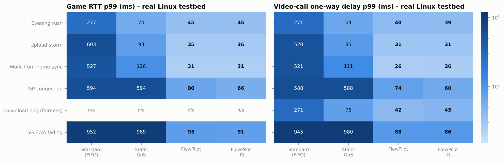

*Figure 1 — real Linux kernel: 99th-percentile game RTT and call one-way delay, every
scenario × router (mean of 2 runs).*

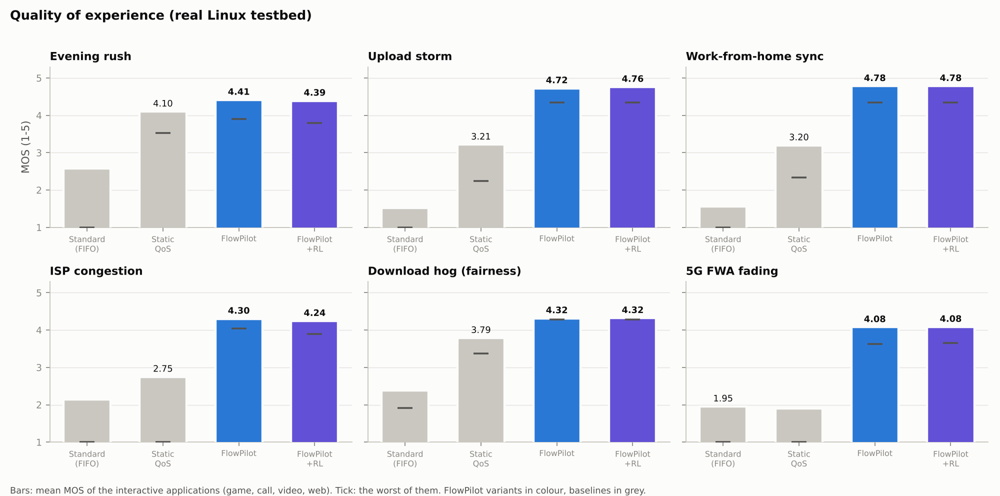

*Figure 2 — real Linux kernel: interactive QoE (bars: mean MOS of game, call, video and web;
tick: the worst of them).*

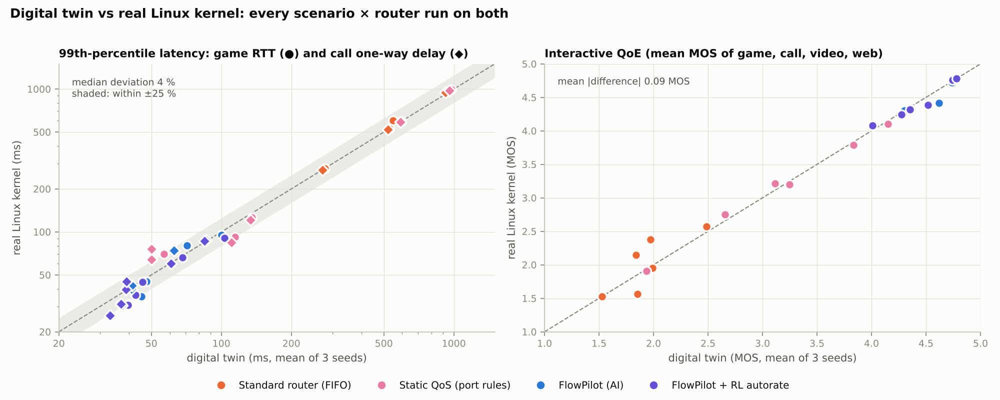

*Figure 3 — the digital twin predicts the real kernel. Each point is one scenario × router:
the twin's value (mean of 3 seeds) on the x-axis, the kernel's on the y-axis; the shaded
band is ±25 %.*

### 7.5 Scenario by scenario (digital twin)

**Evening rush (classic bufferbloat).** The Steam update starts at t = 20 s. Under the
standard router the ISP's 250 ms buffer fills within two seconds and stays full: every
packet of the game and the call waits behind it (Figure 4). FlowPilot classifies the eight
Steam connections as *Bulk* within one control period (sibling inheritance labels the
later ones instantly), gives the game and call guarantees sized on their burst peaks, and
lets the download borrow everything else (Figure 5): the game stays at its ~29 ms base
RTT plus a few ms. On this stable link CAKE is the best AQM and FlowPilot's portable
bfifo variant trails it by ~5 ms at the 99th percentile; with fq_codel leaves it matches
it (44 / 37 ms).

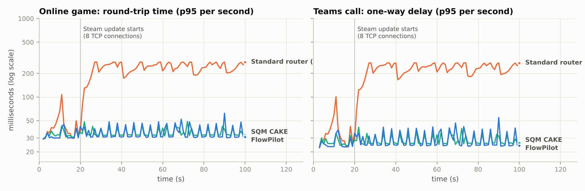

*Figure 4 — evening rush: p95 latency per second. The standard router sits at 200-280 ms
for as long as the download runs; FlowPilot and CAKE stay near the base RTT.*

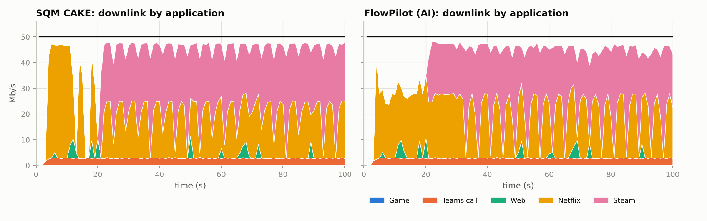

*Figure 5 — downlink by application. FlowPilot lets the download fill every gap (pink)
while the call (orange) and Netflix's ON/OFF segment fetches (yellow) get what they need.*

**Upload storm.** A 10 Mb/s uplink with four photo-backup uploads. FIFO: 548 / 522 ms.
fq_codel keeps the game low (its flow is sparse) but not the call (139 ms), which is *not*
sparse: as one flow among five it is offered ~1.9 Mb/s of a 9.5 Mb/s uplink but needs 3.
CAKE's host isolation helps (68 ms) because the backup runs on a different device. FlowPilot
guarantees the call its measured peak: 37 ms, MOS 4.32, SLO 100 %. Pure TCP ACKs ride in the
Interactive class, so the download that starts at 30 s still gets its ACK clock (41.7 Mb/s).

**Work-from-home sync (same device).** The laptop on the Teams call starts a 4-connection
OneDrive sync. Every fairness-based scheduler fails the same way — fq_codel, CAKE and
CAKE + autorate all put the call at 125-134 ms p99, MOS ≈ 3.0, only 75-77 % of seconds
within SLO — because the call and the sync share a host. FlowPilot: **33 ms, MOS 4.34,
100 %**. The price: the sync uploads at 6.2 instead of 7.7-8.0 Mb/s.

**ISP congestion (capacity drop).** From 45 s to 85 s the access capacity falls from 50/10 to
22/6 Mb/s. Fixed-rate shapers keep shaping at 47.5 Mb/s, so the queue moves into the ISP:
~600 ms for 40 s (Figure 6). FlowPilot's autorate sees the one-way delay jump within
~150 ms, cuts the shaper to 92 % of the delivered rate, and re-probes upwards quickly once
the link recovers (the time-decayed bloat memory of §4.6). CAKE + autorate, using the same
delay logic, behaves similarly; FlowPilot keeps Netflix higher (11.5 vs 10.3 Mb/s).

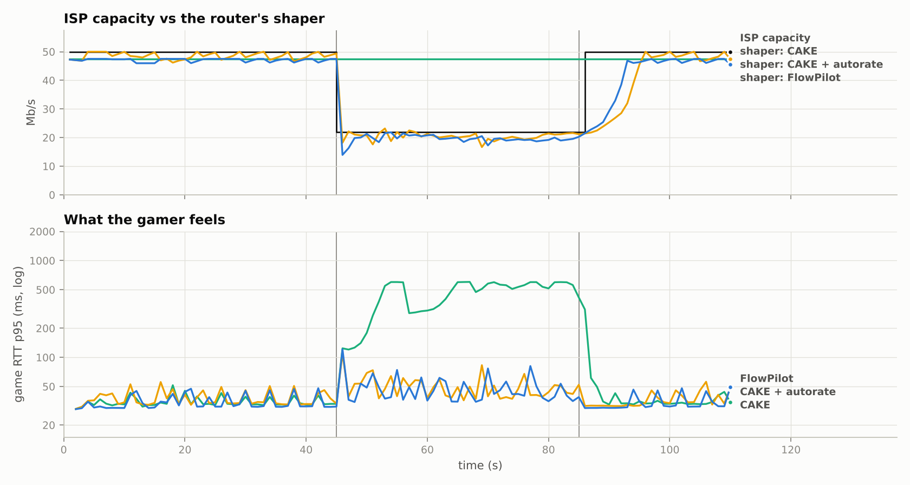

*Figure 6 — top: true ISP capacity and each router's shaper; bottom: what the gamer feels.*

**Download hog (fairness).** A PC opens 16 connections, a tablet downloads over one.
Per-flow fairness (FIFO, fq_codel) hands the PC 94 % of the bandwidth (Jain 0.56-0.57).
CAKE and FlowPilot are both device-fair (Jain 0.98) — FlowPilot through one HTB leaf per
device and a $BDP/\sqrt{n}$ buffer that lets a single connection keep its share — but
FlowPilot additionally keeps the 4K stream at 13.8 Mb/s versus 11.6 Mb/s (Figure 7).

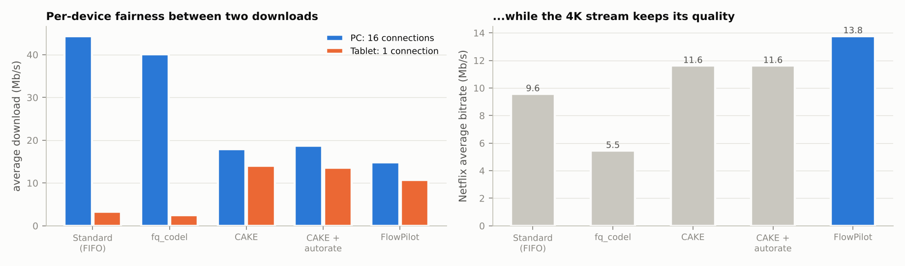

*Figure 7 — left: per-device download rates (seed 1); right: Netflix bitrate under the same load.*

**5G FWA fading.** Capacity wanders between 15 and 60 Mb/s with deep fades (Figure 8). Every
fixed shaper is wrong most of the time: ~1 s latency, 5-7 % of seconds within SLO. Only the
capacity-tracking routers stay usable (85-87 % of seconds within SLO); here the residual-RL
autorate gains 2.8 points of utilisation and slightly lower call delay over FlowPilot's
heuristic (§7.8).

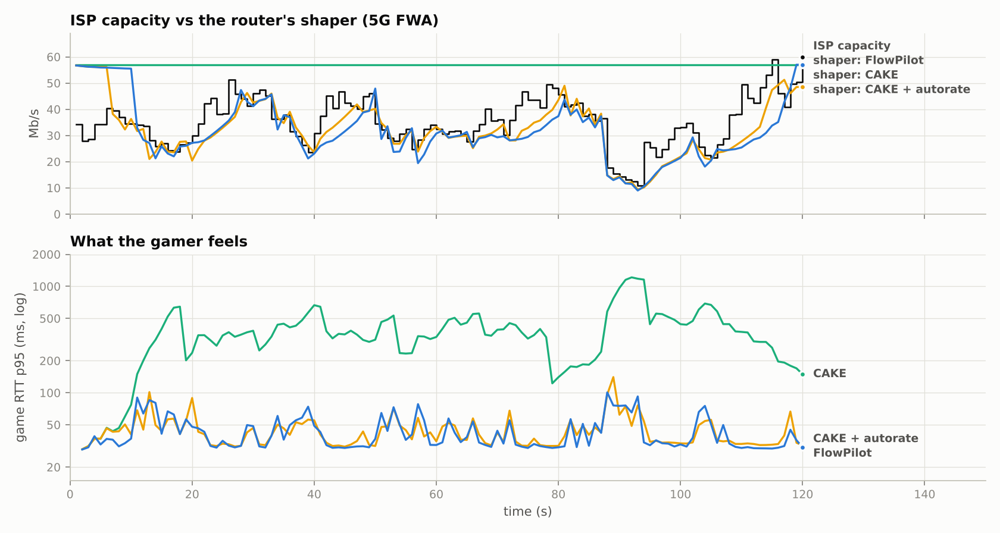

*Figure 8 — 5G FWA: capacity vs shaper, and game latency.*

### 7.6 Latency matrix and QoE

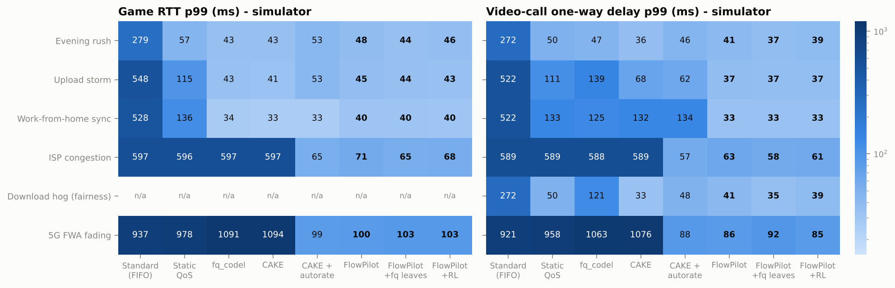

*Figure 9 — 99th-percentile game RTT and call delay, every scenario × router (mean of 3 seeds).*

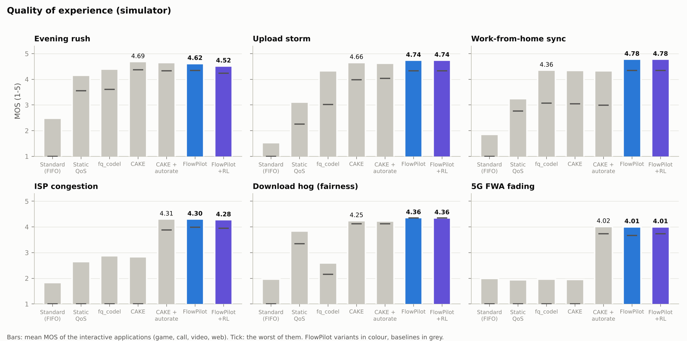

*Figure 10 — interactive QoE (bars: mean MOS of game, call, video and web; tick: the worst of
them). A FlowPilot variant has the best interactive MOS and the best worst-application MOS
in five of six scenarios; the exception is the stable-link evening rush, where CAKE leads by
0.04-0.07 MOS.*

### 7.7 Classification

The classifier card is in §4.4.4: 99.66 % accuracy / 0.993 macro-F1 on unseen households,
99.6 % within the first second of a flow. Live, inside the controller (classifier +
hysteresis + sibling inheritance + traffic protection), every flow that received a label
— including flows that ended long before the run did — was scored against the generator's
ground truth:

| Where | Runs | Correct / labelled flows | Flow accuracy | Byte accuracy (mean; worst run) |
|---|---:|---:|---:|---:|
| Digital twin (FlowPilot, + fq leaves, + RL; 6 scenarios × 3 seeds) | 54 | 3593/3594 | 99.97 % | > 99.99 %; 99.91 % |
| Real Linux kernel (FlowPilot, + RL; 6 scenarios × 2 runs) | 24 | 1490/1608 | **92.7 %** | **99.62 %**; 98.4 % |

Real-kernel confusion matrix (rows: what the flow really was; columns: FlowPilot's label):

| true \ labelled as | game | video call | video streaming | web | download | upload / backup | flows | recall |
|---|---:|---:|---:|---:|---:|---:|---:|---:|
| game | 20 | 0 | 0 | 0 | 0 | 0 | 20 | 100 % |
| video call | 0 | 24 | 0 | 0 | 0 | 0 | 24 | 100 % |
| video streaming | 0 | 0 | 16 | 0 | 0 | 0 | 16 | 100 % |
| web | 0 | 0 | 0 | 1234 | 118 | 0 | 1352 | 91 % |
| download | 0 | 0 | 0 | 0 | 164 | 0 | 164 | 100 % |
| upload / backup | 0 | 0 | 0 | 0 | 0 | 32 | 32 | 100 % |

On real traffic every game, video-call, video-streaming, download and upload flow was labelled correctly. All 118 misses are web connections labelled *Bulk*: 118 of the 1352 real web connections (9 %). They carry little data — hence the 99.62 % byte accuracy — but a page load waits for its slowest connection — the main reason the kernel's page loads are slower than the twin's (§7.4). The digital twin makes it far more rarely (1 of 3018 web connections), so it is a sim-to-real gap in how real kernel TCP shapes short transfers; §10 lists the fix.

### 7.8 Reinforcement-learning autorate

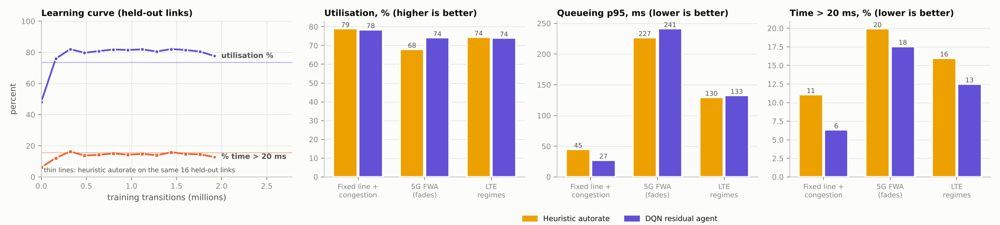

*Figure 11 — left: learning curve on 16 held-out links (thin lines: the heuristic on the same
links); right three panels: 64 held-out links by link type.*

On 64 held-out links of the training model, the residual DQN is **Pareto-better than the
hand-tuned heuristic** overall:

| | Utilisation | Delay p95 | Time with > 20 ms queueing | Mean reward |
|---|---:|---:|---:|---:|
| Static 95 % shaper | 99.8 % | 1 916 ms | 86.1 % | −8.41 |
| Heuristic autorate (cake-autorate style) | 73.1 % | 121 ms | 16.1 % | −0.203 |
| **Residual DQN + shield** | **75.4 %** | 127 ms | **12.7 %** | **−0.091** |

By link type: on fixed lines with congestion steps it halves the time spent above 20 ms
(11.1 → 6.3 %) and cuts the p95 from 45 to 27 ms at equal utilisation; on 5G FWA it gains
6 points of utilisation (68 → 74 %) with less time above 20 ms (20 → 18 %), at a slightly
higher p95 (227 → 241 ms, dominated by deep fades no controller can hide).

**Reading the learning curve.** We judge policies by the two operational criteria in the
figure — utilisation and the share of time with more than 20 ms of queueing — not by the
scalar reward, because the reward's delay penalty dominates: on the 16 learning-curve links
the untrained, always-conservative policy scores a *higher* reward (−0.005) than the final
policy (−0.076) while using only 48 % of the link. Training moves the policy from 48 % / 6 %
to 78 % / 13 %, against the heuristic's 73 % / 16 % on the same links (its reward there is
−0.214; the −0.203 in the table is on the 64 evaluation links). A constrained formulation
(maximise utilisation subject to a delay budget) is the natural next step.

**Transfer to the packet simulator** (same scenarios as §7.1, 3 seeds):

| Scenario | Utilisation heuristic → RL | Game p99 | Call p99 |
|---|---|---|---|
| 5G FWA fading | 78.6 → **81.4 %** | 100 → 103 ms | 86 → **85 ms** |
| ISP congestion | 86.2 → 86.1 % | 71 → **68 ms** | 63 → **61 ms** |
| Evening rush (stable) | 90.0 → 85.2 % | 48 → **46 ms** | 41 → **39 ms** |
| Upload storm (stable) | 89.4 → 86.0 % | 45 → **43 ms** | 37 → **37 ms** |

So the agent transfers where it was meant to help — variable links — and is a little more
conservative than needed on stable lines. FlowPilot therefore ships the heuristic as the
default and the RL policy as the recommended mode for FWA/LTE gateways (§10).

### 7.9 What it costs, and where FlowPilot does not win

* **Bulk throughput.** By design (RFC 8622 "lower effort"), downloads and uploads yield to
  everything else while interactive traffic is active. Against CAKE + autorate they get
  3-39 % less, about 20 % in a typical contended scenario: 24.0 vs 26.3 Mb/s in the evening
  rush, 15.3 vs 19.4 in ISP congestion, 25.5 vs 32.5 for the download hog, 6.2 vs 8.0 Mb/s
  uplink in WFH sync and 8.5 vs 14.0 under FWA fading — the bandwidth that kept Netflix in
  4K and the call clean. Selecting a different intent changes this trade-off.
* **Utilisation.** FlowPilot shapes at ≤ 95 % of the plan (the SQM margin) and cuts on
  bufferbloat, so it uses 2-3 points less of the link than CAKE + autorate (which may probe
  to 100 %).
* **Stable-link tail latency.** With plain bfifo leaves, FlowPilot's p99 is ~5 ms above
  CAKE's on a stable line (game 48 vs 43 ms); the fq_codel-leaf variant closes the gap where
  the kernel offers fq_codel.
* **FWA game latency.** Under deep fades every capacity-tracking router briefly reaches
  ~100 ms; FlowPilot is not better than CAKE + autorate there (100 vs 99 ms).
* **QoE fairness on variable links** is lower than CAKE + autorate's (§7.3), the mirror image
  of the bulk-throughput cost.

## 8. Demo script (5 minutes, for the judges)

Start the stack (`./scripts/run_demo.sh` or `docker compose up`), open
`http://localhost:8000`.

1. **The setup (30 s).** *Live* tab → Network **Simulation (digital twin)**, Router
   **FlowPilot (AI)**, Compare with **Standard router (FIFO)**, Scenario **Live household**,
   **Start session**. Two identical simulated homes appear
   side by side: a CS2 game, a Teams call, 4K Netflix and a phone browsing, on a 50/10 Mb/s
   plan. Both are green — with no congestion every router is fine.
2. **Congestion (60 s).** Click **Steam update** (8 TCP connections). Within two seconds
   the left home's game ping climbs past 200 ms and its call turns red (MOS ~2, frozen video);
   on the right FlowPilot's feed shows *"pc: TCP flow to 203.0.113.13:443 is Bulk download
   (100 %) → Bulk"* and the game stays at ~30 ms, the call at MOS ≈ 4.3. The banner states
   the factor live (e.g. *"7.1× lower gaming latency with FlowPilot"*). Point at the class
   allocation panel: bulk gets everything nobody else needs — it is throttled, not starved.
3. **Same-laptop sync (45 s).** Click **OneDrive sync (laptop)** — the same laptop that is
   on the call. Explain why per-host fairness (CAKE) cannot fix this one and FlowPilot does:
   it knows which flow is the call.
4. **The ISP misbehaves (60 s).** Click **ISP congestion −55%**. The feed shows
   *"Bufferbloat on the downlink (+31 ms): ISP capacity fell, shaper 47.5 → 21.3 Mb/s"*; the
   game blips once and recovers. Click **Restore ISP** — within a few seconds the shaper
   climbs back.
5. **Intent (30 s).** Switch the FlowPilot side's **Intent** to *movie night* or *work from
   home* and watch the guarantees move.
6. **Proof (60 s).** *Benchmarks* tab: per-scenario comparison of all routers (latency,
   MOS, video bitrate, page load, throughput), from PostgreSQL, with a switch between the
   digital twin and the real Linux kernel results. *AI models* tab: classifier card
   (99.7 %), accuracy vs flow age, RL learning curve. Mention that the same controller runs
   on the real Linux kernel testbed (§7.4) and that the dashboard can drive it
   (`sudo -E ./scripts/run_demo.sh`, Network **Linux testbed (real kernel)**).

---

## 9. Deployment path and value

**On a real gateway.** FlowPilot's runtime is three cooperating parts that map directly
onto RDK-B, prplOS or OpenWrt:

| FlowPilot part | On a CPE | Resource use measured here |
|---|---|---|
| data plane | kernel HTB + bfifo/fq_codel + nftables + conntrack (all stock) | kernel only |
| flow monitor | AF_PACKET (or conntrack accounting / eBPF on SoCs with HW-NAT) | ~6 k pkt/s at 50 Mb/s in one Python process; a C/eBPF port is the production path |
| controller | 500 ms loop; ~25 ms per step for ~30 flows in Python; classifier ~0.1 ms/flow | < 10 % of one core |
| reporting | TR-181 vendor extension objects (`Device.X_FlowPilot.Classes.{i}`), TR-369/USP events | — |

* **Hardware offload:** SoC flow accelerators bypass the kernel qdiscs; as with SQM, shaped
  directions must not be offloaded (or the offload engine's own scheduler must be
  programmed with the same plan).
* **Wi-Fi:** DSCP written per class lets WMM (RFC 8325) apply the same priorities on the
  air, where the next bottleneck often is.
* **L4S/NQB-ready:** real-time traffic is marked DSCP 45 (NQB) and protected; an ISP that
  supports NQB or Low-Latency DOCSIS carries the separation end to end.
* **5G FWA (Tata Elxsi's RDK-B on Qualcomm FWA [27]):** the RL autorate is aimed exactly at
  fading radio links; the heuristic is the default for fixed lines.
* **Privacy by design:** no payload inspection, no port lists, no cloud dependency; the
  learned profiles never leave the gateway unless the operator's USP controller asks.

**Value.** For households: games and calls that stay usable while the house downloads.
For operators: fewer "my internet is slow" calls on links that are actually fine,
premium "gaming / work-from-home" experiences that are *user-chosen intents* rather than
paid prioritisation, and per-home QoE telemetry (who is suffering, why) for network
planning — all on existing CPE.

---

## 10. Limitations and what we would do next

* **Synthetic training traffic.** The classifier is trained on randomised simulated
  applications and validated on real-kernel traffic generated by our own programs, not on
  captures of the commercial apps. Next: fine-tune on public encrypted-traffic datasets
  (e.g. ISCX VPN-nonVPN, CESNET QUIC) and on opt-in captures; add QUIC-specific cases
  (YouTube over UDP/443 would today hit traffic protection and fall back to Bulk —
  correct for latency, but the stream would lose its Streaming guarantee).
* **Kernel testbed coverage.** Our VM kernel lacks fq_codel, CAKE and netem, so those
  baselines run only in the digital twin; the kernel runs compare FIFO, static QoS,
  FlowPilot and FlowPilot + RL. On a stock kernel the same harness runs them all. Each
  kernel cell is the mean of two real-time runs; FlowPilot's game p99 differed between
  the two runs by 2-11 ms (static QoS by up to 16 ms on the fixed-capacity scenarios), so
  differences of a few ms between the FlowPilot variants on the kernel are not
  significant.
* **The cost is real.** Lower-effort bulk transfers get 3-39 % (typically ~20 %) less
  throughput than under CAKE + autorate in the contended scenarios — the price of
  protecting calls and 4K video. A household that wants the download first selects a
  different intent.
* **Sim-to-real gap in classification.** On the real kernel a minority of web connections
  (9 % of them) is labelled *Bulk*, which slows the page loads they belong to
  (§7.4, §7.7). The simulator never shows this, so real kernel TCP makes some page fetches
  look like the start of a download. Next: a byte-volume grace period before a flow may be
  demoted to Bulk, and fine-tuning on real traces.
* **RL generalisation.** The residual DQN improves the variable-link (FWA) cases but is
  slightly more conservative than the heuristic on stable lines in the packet simulator
  (−3 to −5 points utilisation). Next: fine-tune in the packet simulator / on the testbed,
  and a link-type detector that enables RL only on variable links.
* **Wi-Fi airtime** is not modelled (the LAN is assumed fast); an airtime-fairness module
  would be the next bottleneck to tackle.
* **Ingress shaping is inherently imperfect:** sudden downlink bursts from many senders
  still briefly queue at the ISP (visible as 10-20 ms blips); only ISP-side AQM, L4S or a
  bigger margin remove them completely.
* **Python data path components** (flow monitor) are fine at 50-100 Mb/s; gigabit plans
  need the eBPF/conntrack-accounting variant.

---

## 11. How to run and reproduce

```bash
# dashboard + API (simulator mode, any OS)
cd frontend && npm ci && npm run build && cd ../backend
pip install -r requirements.txt && python -m flowpilot.api          # http://localhost:8000

# with PostgreSQL
docker compose up --build

# real-kernel testbed (Linux, root)
sudo ./scripts/setup_testbed.sh
sudo python -m flowpilot.bench.kernel_runner --scenario evening_rush --scheduler fifo
sudo python -m flowpilot.bench.kernel_runner --scenario evening_rush --scheduler flowpilot

# every number in this report
./scripts/bench_all.sh
python -m pytest -q
```

| Artefact | Produced by | File |
|---|---|---|
| training data (122 664 samples) | `flowpilot.ml.dataset` | `backend/data/flows_sim.npz` (not committed, 7 MB) |
| classifier + model card | `flowpilot.ml.train_classifier` | `backend/flowpilot/models/flow_classifier.joblib`, `backend/data/classifier_report.json` |
| RL policy + report | `flowpilot.ml.rl.train` | `backend/flowpilot/models/autorate_dqn.npz`, `backend/data/rl_report.json` |
| simulator benchmark (144 runs) | `flowpilot.bench.run_bench` | `backend/results/sim_bench.json.gz` |
| kernel benchmark | `flowpilot.bench.kernel_bench` | `backend/results/kernel_bench.json` |
| figures | `flowpilot.bench.plots` | `docs/figures/*.png` |
| every table in §7 and the appendices | `flowpilot.bench.report_tables` | printed as Markdown |

---

## 12. References

1. J. Gettys, K. Nichols. *Bufferbloat: Dark Buffers in the Internet.* ACM Queue 9(11), 2011.
2. V. Cerf, V. Jacobson, N. Weaver, J. Gettys. *BufferBloat: What's Wrong with the Internet?* Communications of the ACM 55(2), 2012. https://queue.acm.org/detail.cfm?id=2076798
3. K. Nichols, V. Jacobson, A. McGregor, J. Iyengar. *Controlled Delay Active Queue Management.* RFC 8289, 2018; T. Høiland-Jørgensen, P. McKenney, D. Täht, J. Gettys, E. Dumazet. *The Flow Queue CoDel Packet Scheduler and AQM Algorithm.* RFC 8290, 2018.
4. T. Høiland-Jørgensen, D. Täht, J. Morton. *Piece of CAKE: A Comprehensive Queue Management Solution for Home Gateways.* IEEE LANMAN 2018, arXiv:1804.07617.
5. cake-autorate. https://github.com/lynxthecat/cake-autorate
6. B. Briscoe, K. De Schepper, M. Bagnulo, G. White. *Low Latency, Low Loss, and Scalable Throughput (L4S) Internet Service: Architecture.* RFC 9330, 2023.
7. K. De Schepper, B. Briscoe, G. White. *Dual-Queue Coupled Active Queue Management (AQM) for Low Latency, Low Loss, and Scalable Throughput (L4S).* RFC 9332, 2023.
8. G. White, T. Fossati, R. Geib. *A Non-Queue-Building Per-Hop Behavior (NQB PHB) for Differentiated Services.* RFC 9956, 2026.
9. OpenWrt. *SQM (Smart Queue Management).* https://openwrt.org/docs/guide-user/network/traffic-shaping/sqm
10. J. Babiarz, K. Chan, F. Baker. *Configuration Guidelines for DiffServ Service Classes.* RFC 4594, 2006.
11. R. Bless. *A Lower-Effort Per-Hop Behavior (LE PHB) for Differentiated Services.* RFC 8622, 2019.
12. T. Szigeti, J. Henry, F. Baker. *Mapping Diffserv to IEEE 802.11.* RFC 8325, 2018.
13. S. Rezaei, X. Liu. *Deep Learning for Encrypted Traffic Classification: An Overview.* arXiv:1810.07906, 2018.
14. *A Survey on Analyzing Encrypted Network Traffic of Mobile Devices.* arXiv:2006.12352, 2020.
15. *Robust Machine Learning for Encrypted Traffic Classification.* arXiv:1603.04865, 2016.
16. H. Mao, R. Netravali, M. Alizadeh. *Neural Adaptive Video Streaming with Pensieve.* ACM SIGCOMM 2017.
17. L. Chen, J. Lingys, K. Chen, F. Liu. *AuTO: Scaling Deep Reinforcement Learning for Datacenter-Scale Automatic Traffic Optimization.* ACM SIGCOMM 2018.
18. N. Jay, N. Rotman, B. Godfrey, M. Schapira, A. Tamar. *A Deep Reinforcement Learning Perspective on Internet Congestion Control.* ICML 2019.
19. T. Silver, K. Allen, J. Tenenbaum, L. Kaelbling. *Residual Policy Learning.* arXiv:1812.06298, 2018; T. Johannink et al. *Residual Reinforcement Learning for Robot Control.* ICRA 2019.
20. M. Alshiekh, R. Bloem, R. Ehlers, B. Könighofer, S. Niekum, U. Topcu. *Safe Reinforcement Learning via Shielding.* AAAI 2018.
21. ITU-T G.107. *The E-model: a computational model for use in transmission planning*; R. G. Cole, J. H. Rosenbluth. *Voice over IP Performance Monitoring.* ACM SIGCOMM CCR 31(2), 2001.
22. ITU-T G.114. *One-way transmission time.* 2003.
23. X. Xu, S. Liu, M. Claypool. *The Effects of Network Latency on Counter-strike: Global Offensive Players.* QoMEX 2022.
24. F. Dobrian et al. *Understanding the Impact of Video Quality on User Engagement.* ACM SIGCOMM 2011.
25. R. Jain, D. Chiu, W. Hawe. *A Quantitative Measure of Fairness and Discrimination for Resource Allocation in Shared Computer Systems.* DEC TR-301, 1984.
26. T. Hoßfeld, L. Skorin-Kapov, P. E. Heegaard, M. Varela. *Definition of QoE Fairness in Shared Systems.* IEEE Communications Letters 21(1):184-187, 2017.
27. Tata Elxsi. *Tata Elxsi Delivers World's First RDK-B Integration on Qualcomm 5G Fixed Wireless Access Platform.* Press release, September 2024.
28. Broadband Forum. *TR-181 Device:2 Data Model*; *TR-369 User Services Platform (USP).*
29. S. Shenker. *Fundamental Design Issues for the Future Internet.* IEEE JSAC 13(7), 1995.
30. F. Kelly, A. Maulloo, D. Tan. *Rate control for communication networks: shadow prices, proportional fairness and stability.* Journal of the Operational Research Society 49, 1998.
31. G. Appenzeller, I. Keslassy, N. McKeown. *Sizing Router Buffers.* ACM SIGCOMM 2004.
32. T.-Y. Huang, R. Johari, N. McKeown, M. Trunnell, M. Watson. *A Buffer-Based Approach to Rate Adaptation: Evidence from a Large Video Streaming Service.* ACM SIGCOMM 2014.
33. X. Yin, A. Jindal, V. Sekar, B. Sinopoli. *A Control-Theoretic Approach for Dynamic Adaptive Video Streaming over HTTP.* ACM SIGCOMM 2015.
34. Netflix Help Center. *Internet connection speed recommendations* (3 / 5 / 15 Mb/s for HD / Full HD / 4K).
35. Zoom bandwidth guidance (1080p group video: ≈ 2.5 Mb/s down, 3.0 Mb/s up), as republished by university IT knowledge bases.
36. Deloitte. *Connectivity and Mobile Trends* (≈ 21-25 connected devices per US household, 2021-2023).
37. ITU-T P.1203 (adaptive streaming QoE), G.1030 (web QoE), G.1072 (gaming QoE).
38. C. Paasch, R. Meyer, S. Cheshire, W. Hawkins. *Responsiveness under Working Conditions.* draft-ietf-ippm-responsiveness.

---

## Appendix A — full simulator results

Mean of 3 seeds per cell; generated by `python -m flowpilot.bench.report_tables`.

### Evening rush — digital twin

*Game + Teams call + 4K Netflix + web browsing; at t=20 s a Steam update opens 8 TCP connections.*

**Latency and loss**

| Router | Game RTT p50 (ms) | Game RTT p99 (ms) | Game loss (%) | Call OWD p99 (ms) | Call loss (%) | Call frames late (%) | Within SLO (% s) |
|---|---:|---:|---:|---:|---:|---:|---:|
| Standard router (FIFO) | 219 | 279 | 0.02 | 272 | 0.03 | 21.3 | 17 |
| Static QoS (port rules) | **30** | 57 | **0.00** | 50 | **0.00** | **0.0** | 98 |
| SQM fq_codel | 31 | **43** | **0.00** | 47 | 0.02 | 0.1 | **100** |
| SQM CAKE | 31 | **43** | **0.00** | **36** | **0.00** | **0.0** | **100** |
| CAKE + autorate | 31 | 53 | **0.00** | 46 | **0.00** | **0.0** | 99 |
| **FlowPilot (AI)** | **30** | 48 | **0.00** | 41 | **0.00** | **0.0** | **100** |
| **FlowPilot + fq_codel leaves** | **30** | 44 | **0.00** | 37 | **0.00** | **0.0** | **100** |
| **FlowPilot + RL autorate** | **30** | 46 | **0.00** | 39 | **0.00** | **0.0** | **100** |

<sub>mean of 3 seeds; best value per column in bold.</sub>

**Experience, fairness and throughput**

| Router | Call MOS | Netflix (Mb/s) | Rebuffering (%) | Web PLT p50 (s) | Interactive MOS | QoE fairness F | Download (Mb/s) | Utilisation (%) |
|---|---:|---:|---:|---:|---:|---:|---:|---:|
| Standard router (FIFO) | 3.25 | 5.7 | 1.9 | 2.71 | 2.49 | 0.35 | **45.6** | **97** |
| Static QoS (port rules) | 4.33 | 7.1 | **0.0** | 1.23 | 4.15 | 0.71 | 38.7 | 94 |
| SQM fq_codel | 4.27 | 7.2 | **0.0** | 0.62 | 4.39 | 0.75 | 38.6 | 94 |
| SQM CAKE | **4.37** | **14.1** | **0.0** | **0.49** | **4.69** | 0.82 | 25.7 | 91 |
| CAKE + autorate | 4.34 | **14.1** | **0.0** | 0.50 | 4.65 | **0.84** | 26.3 | 92 |
| **FlowPilot (AI)** | 4.35 | **14.1** | **0.0** | 0.63 | 4.62 | 0.81 | 24.0 | 90 |
| **FlowPilot + fq_codel leaves** | 4.35 | **14.1** | **0.0** | 0.56 | 4.65 | 0.81 | 24.3 | 91 |
| **FlowPilot + RL autorate** | **4.37** | **14.1** | **0.0** | 0.85 | 4.52 | 0.77 | 21.5 | 85 |

<sub>mean of 3 seeds; best value per column in bold.</sub>

### Upload storm — digital twin

*Game + call + web; at 15 s a tablet backs up photos (4 uploads), at 30 s a download starts.*

**Latency and loss**

| Router | Game RTT p50 (ms) | Game RTT p99 (ms) | Game loss (%) | Call OWD p99 (ms) | Call loss (%) | Call frames late (%) | Within SLO (% s) |
|---|---:|---:|---:|---:|---:|---:|---:|
| Standard router (FIFO) | 395 | 548 | 0.02 | 522 | 0.11 | 73.1 | 15 |
| Static QoS (port rules) | 53 | 115 | 0.53 | 111 | 1.02 | 3.0 | 45 |
| SQM fq_codel | 32 | 43 | **0.00** | 139 | 2.15 | 11.6 | 76 |
| SQM CAKE | 32 | **41** | **0.00** | 68 | 0.11 | 1.3 | 99 |
| CAKE + autorate | 33 | 53 | **0.00** | 62 | 0.11 | 1.0 | 98 |
| **FlowPilot (AI)** | 32 | 45 | **0.00** | **37** | **0.00** | **0.0** | **100** |
| **FlowPilot + fq_codel leaves** | 32 | 44 | **0.00** | **37** | **0.00** | **0.0** | **100** |
| **FlowPilot + RL autorate** | **31** | 43 | **0.00** | **37** | **0.00** | 0.1 | **100** |

<sub>mean of 3 seeds; best value per column in bold.</sub>

**Experience, fairness and throughput**

| Router | Call MOS | Web PLT p50 (s) | Interactive MOS | QoE fairness F | Download (Mb/s) | Upload (Mb/s) | Utilisation (%) |
|---|---:|---:|---:|---:|---:|---:|---:|
| Standard router (FIFO) | 1.66 | 4.55 | 1.53 | 0.33 | 27.5 | **8.7** | 59 |
| Static QoS (port rules) | 3.21 | 3.58 | 3.11 | 0.59 | 42.2 | 6.6 | 89 |
| SQM fq_codel | 3.02 | 0.47 | 4.33 | 0.64 | 41.3 | 7.1 | 89 |
| SQM CAKE | 3.98 | **0.43** | 4.66 | 0.78 | 41.5 | 5.4 | 89 |
| CAKE + autorate | 4.03 | 0.47 | 4.63 | **0.82** | **43.2** | 5.9 | **92** |
| **FlowPilot (AI)** | 4.32 | 0.52 | **4.74** | **0.82** | 41.7 | 5.3 | 89 |
| **FlowPilot + fq_codel leaves** | 4.32 | 0.62 | 4.67 | **0.82** | 42.1 | 5.4 | 90 |
| **FlowPilot + RL autorate** | **4.33** | 0.49 | **4.74** | 0.80 | 40.0 | 5.2 | 86 |

<sub>mean of 3 seeds; best value per column in bold.</sub>

### Work-from-home sync — digital twin

*The laptop is on a Teams call while OneDrive syncs a folder (4 uploads) from the same laptop.*

**Latency and loss**

| Router | Game RTT p50 (ms) | Game RTT p99 (ms) | Game loss (%) | Call OWD p99 (ms) | Call loss (%) | Call frames late (%) | Within SLO (% s) |
|---|---:|---:|---:|---:|---:|---:|---:|
| Standard router (FIFO) | 383 | 528 | 0.02 | 522 | 0.05 | 72.9 | 17 |
| Static QoS (port rules) | 36 | 136 | **0.00** | 133 | **0.00** | **0.0** | 48 |
| SQM fq_codel | 31 | 34 | **0.00** | 125 | 2.05 | 12.8 | 75 |
| SQM CAKE | 31 | **33** | **0.00** | 132 | 2.17 | 12.8 | 77 |
| CAKE + autorate | 31 | **33** | **0.00** | 134 | 1.84 | 14.1 | 75 |
| **FlowPilot (AI)** | **30** | 40 | **0.00** | **33** | **0.00** | **0.0** | **100** |
| **FlowPilot + fq_codel leaves** | **30** | 40 | **0.00** | **33** | **0.00** | **0.0** | **100** |
| **FlowPilot + RL autorate** | **30** | 40 | **0.00** | **33** | **0.00** | **0.0** | **100** |

<sub>mean of 3 seeds; best value per column in bold.</sub>

**Experience, fairness and throughput**

| Router | Call MOS | Web PLT p50 (s) | Interactive MOS | QoE fairness F | Upload (Mb/s) |
|---|---:|---:|---:|---:|---:|
| Standard router (FIFO) | 1.85 | 2.92 | 1.85 | 0.24 | **9.2** |
| Static QoS (port rules) | 3.20 | 2.49 | 3.25 | 0.66 | 6.7 |
| SQM fq_codel | 3.07 | 0.41 | 4.36 | 0.60 | 7.7 |
| SQM CAKE | 3.04 | **0.37** | 4.35 | 0.59 | 7.7 |
| CAKE + autorate | 2.99 | 0.40 | 4.33 | 0.57 | 8.0 |
| **FlowPilot (AI)** | **4.34** | **0.37** | **4.78** | **0.85** | 6.2 |
| **FlowPilot + fq_codel leaves** | **4.34** | 0.39 | **4.78** | **0.85** | 6.2 |
| **FlowPilot + RL autorate** | **4.34** | **0.37** | **4.78** | **0.85** | 6.1 |

<sub>mean of 3 seeds; best value per column in bold.</sub>

### ISP congestion — digital twin

*Evening-rush traffic; from 45 s to 85 s the ISP capacity drops from 50/10 to 22/6 Mb/s.*

**Latency and loss**

| Router | Game RTT p50 (ms) | Game RTT p99 (ms) | Game loss (%) | Call OWD p99 (ms) | Call loss (%) | Call frames late (%) | Within SLO (% s) |
|---|---:|---:|---:|---:|---:|---:|---:|
| Standard router (FIFO) | 251 | 597 | 0.05 | 589 | 0.02 | 50.4 | 11 |
| Static QoS (port rules) | 33 | 596 | 0.02 | 589 | 0.01 | 36.6 | 59 |
| SQM fq_codel | 32 | 597 | 0.01 | 588 | 0.02 | 31.6 | 61 |
| SQM CAKE | 32 | 597 | 0.01 | 589 | 0.01 | 32.1 | 61 |
| CAKE + autorate | 33 | **65** | **0.00** | **57** | **0.00** | **0.0** | 95 |
| **FlowPilot (AI)** | **30** | 71 | **0.00** | 63 | **0.00** | **0.0** | 96 |
| **FlowPilot + fq_codel leaves** | **30** | **65** | **0.00** | 58 | **0.00** | **0.0** | **97** |
| **FlowPilot + RL autorate** | **30** | 68 | **0.00** | 61 | **0.00** | **0.0** | 96 |

<sub>mean of 3 seeds; best value per column in bold.</sub>

**Experience, fairness and throughput**

| Router | Call MOS | Netflix (Mb/s) | Rebuffering (%) | Web PLT p50 (s) | Interactive MOS | QoE fairness F | Download (Mb/s) | Utilisation (%) |
|---|---:|---:|---:|---:|---:|---:|---:|---:|
| Standard router (FIFO) | 2.40 | 4.6 | 7.5 | 3.79 | 1.84 | 0.32 | **34.8** | **99** |
| Static QoS (port rules) | 3.09 | 5.3 | 0.4 | 1.60 | 2.66 | 0.39 | 31.0 | 96 |
| SQM fq_codel | 3.19 | 5.5 | **0.0** | 1.02 | 2.88 | 0.37 | 30.5 | 96 |
| SQM CAKE | 3.24 | 11.4 | 6.3 | **0.77** | 2.83 | 0.37 | 22.2 | 94 |
| CAKE + autorate | 4.23 | 10.3 | **0.0** | 0.83 | 4.31 | **0.82** | 19.4 | 89 |
| **FlowPilot (AI)** | 4.20 | 11.5 | **0.0** | 0.95 | 4.30 | 0.76 | 15.3 | 86 |
| **FlowPilot + fq_codel leaves** | **4.25** | 11.5 | **0.0** | 0.83 | **4.37** | 0.76 | 15.7 | 87 |
| **FlowPilot + RL autorate** | 4.19 | **11.7** | **0.0** | 1.04 | 4.28 | 0.76 | 15.0 | 86 |

<sub>mean of 3 seeds; best value per column in bold.</sub>

### Download hog (fairness) — digital twin

*A PC opens 16 connections while a tablet downloads with 1; plus a call and 4K Netflix.*

**Latency and loss**

| Router | Call OWD p99 (ms) | Call loss (%) | Call frames late (%) | Within SLO (% s) |
|---|---:|---:|---:|---:|
| Standard router (FIFO) | 272 | 0.02 | 30.5 | 12 |
| Static QoS (port rules) | 50 | **0.00** | **0.0** | **100** |
| SQM fq_codel | 121 | 1.92 | 14.1 | 54 |
| SQM CAKE | **33** | **0.00** | **0.0** | **100** |
| CAKE + autorate | 48 | **0.00** | **0.0** | **100** |
| **FlowPilot (AI)** | 41 | **0.00** | **0.0** | **100** |
| **FlowPilot + fq_codel leaves** | 35 | **0.00** | **0.0** | **100** |
| **FlowPilot + RL autorate** | 39 | **0.00** | **0.0** | **100** |

<sub>mean of 3 seeds; best value per column in bold.</sub>

**Experience, fairness and throughput**

| Router | Call MOS | Netflix (Mb/s) | Rebuffering (%) | Interactive MOS | QoE fairness F | Jain (devices) | Download (Mb/s) | Utilisation (%) |
|---|---:|---:|---:|---:|---:|---:|---:|---:|
| Standard router (FIFO) | 2.94 | 9.3 | 33.8 | 1.97 | 0.23 | 0.57 | **47.5** | **98** |
| Static QoS (port rules) | 4.33 | 5.6 | **0.0** | 3.84 | 0.33 | 0.56 | 41.6 | 95 |
| SQM fq_codel | 3.02 | 5.5 | 3.2 | 2.59 | 0.34 | 0.56 | 42.7 | 95 |
| SQM CAKE | **4.37** | 11.6 | **0.0** | 4.25 | **0.82** | **0.98** | 32.1 | 95 |
| CAKE + autorate | 4.35 | 11.6 | **0.0** | 4.23 | 0.81 | 0.97 | 32.5 | 95 |
| **FlowPilot (AI)** | **4.37** | **13.8** | **0.0** | **4.36** | **0.82** | **0.98** | 25.5 | 92 |
| **FlowPilot + fq_codel leaves** | **4.37** | **13.8** | **0.0** | **4.36** | 0.62 | 0.87 | 26.3 | 94 |
| **FlowPilot + RL autorate** | 4.36 | **13.8** | **0.0** | **4.36** | 0.79 | **0.98** | 23.2 | 88 |

<sub>mean of 3 seeds; best value per column in bold.</sub>

### 5G FWA fading — digital twin

*Family traffic over 5G fixed-wireless: capacity wanders 15-60 Mb/s with deep fades.*

**Latency and loss**

| Router | Game RTT p50 (ms) | Game RTT p99 (ms) | Game loss (%) | Call OWD p99 (ms) | Call loss (%) | Call frames late (%) | Within SLO (% s) |
|---|---:|---:|---:|---:|---:|---:|---:|
| Standard router (FIFO) | 348 | 937 | 0.02 | 921 | 0.03 | 75.3 | 5 |
| Static QoS (port rules) | 339 | 978 | 0.02 | 958 | 0.02 | 76.5 | 5 |
| SQM fq_codel | 339 | 1091 | 0.03 | 1063 | 0.04 | 73.7 | 7 |
| SQM CAKE | 334 | 1094 | 0.02 | 1076 | 0.05 | 73.7 | 7 |
| CAKE + autorate | 33 | **99** | **0.00** | 88 | 0.19 | 1.5 | 85 |
| **FlowPilot (AI)** | **31** | 100 | **0.00** | 86 | **0.01** | 1.4 | 85 |
| **FlowPilot + fq_codel leaves** | **31** | 103 | **0.00** | 92 | 0.26 | 2.0 | **87** |
| **FlowPilot + RL autorate** | 32 | 103 | **0.00** | **85** | **0.01** | **0.1** | 85 |

<sub>mean of 3 seeds; best value per column in bold.</sub>

**Experience, fairness and throughput**

| Router | Call MOS | Netflix (Mb/s) | Rebuffering (%) | Web PLT p50 (s) | Interactive MOS | QoE fairness F | Download (Mb/s) | Utilisation (%) |
|---|---:|---:|---:|---:|---:|---:|---:|---:|
| Standard router (FIFO) | 1.61 | 6.3 | **0.0** | 4.50 | 1.99 | 0.30 | 26.6 | **99** |
| Static QoS (port rules) | 1.58 | 6.3 | 1.4 | 4.34 | 1.93 | 0.31 | 26.6 | 98 |
| SQM fq_codel | 1.67 | 5.5 | 3.6 | 3.35 | 1.96 | 0.31 | **27.6** | 98 |
| SQM CAKE | 1.69 | 5.8 | 3.6 | 3.38 | 1.96 | 0.31 | 27.5 | 98 |
| CAKE + autorate | 3.84 | 9.0 | **0.0** | **1.02** | 4.02 | **0.83** | 14.0 | 82 |
| **FlowPilot (AI)** | **3.92** | 11.9 | **0.0** | 1.31 | 4.01 | 0.71 | 8.5 | 79 |
| **FlowPilot + fq_codel leaves** | 3.90 | 11.9 | **0.0** | 1.14 | **4.06** | 0.73 | 9.3 | 81 |
| **FlowPilot + RL autorate** | 3.90 | **12.0** | **0.0** | 1.24 | 4.01 | 0.75 | 9.5 | 81 |

<sub>mean of 3 seeds; best value per column in bold.</sub>

---

## Appendix B — full real-kernel results

Real Linux kernel, mean of 2 runs per cell; generated by `python -m flowpilot.bench.report_tables`.

### Evening rush — real Linux kernel

*Game + Teams call + 4K Netflix + web browsing; at t=20 s a Steam update opens 8 TCP connections.*

**Latency and loss**

| Router | Game RTT p50 (ms) | Game RTT p99 (ms) | Game loss (%) | Call OWD p99 (ms) | Call loss (%) | Call frames late (%) | Within SLO (% s) |
|---|---:|---:|---:|---:|---:|---:|---:|
| Standard router (FIFO) | 240 | 277 | **0.00** | 271 | **0.04** | 25.7 | 6 |
| Static QoS (port rules) | **28** | 70 | **0.00** | 64 | **0.04** | **0.0** | 96 |
| **FlowPilot (AI)** | **28** | **45** | **0.00** | 40 | **0.04** | 0.1 | **99** |
| **FlowPilot + RL autorate** | **28** | **45** | **0.00** | **39** | **0.04** | 0.1 | **99** |

<sub>real Linux kernel, mean of 2 runs; best value per column in bold.</sub>

**Experience, fairness and throughput**

| Router | Call MOS | Netflix (Mb/s) | Rebuffering (%) | Web PLT p50 (s) | Interactive MOS | QoE fairness F | Download (Mb/s) | Utilisation (%) |
|---|---:|---:|---:|---:|---:|---:|---:|---:|
| Standard router (FIFO) | 2.93 | 7.6 | **0.0** | 2.52 | 2.57 | 0.35 | **42.4** | **98** |
| Static QoS (port rules) | 4.24 | 7.0 | **0.0** | 1.29 | 4.10 | 0.72 | 38.0 | 93 |
| **FlowPilot (AI)** | 4.31 | **14.1** | **0.0** | **1.10** | **4.41** | **0.79** | 23.5 | 87 |
| **FlowPilot + RL autorate** | **4.32** | **14.1** | **0.0** | 1.19 | 4.39 | 0.77 | 23.4 | 87 |

<sub>real Linux kernel, mean of 2 runs; best value per column in bold.</sub>

### Upload storm — real Linux kernel

*Game + call + web; at 15 s a tablet backs up photos (4 uploads), at 30 s a download starts.*

**Latency and loss**

| Router | Game RTT p50 (ms) | Game RTT p99 (ms) | Game loss (%) | Call OWD p99 (ms) | Call loss (%) | Call frames late (%) | Within SLO (% s) |
|---|---:|---:|---:|---:|---:|---:|---:|
| Standard router (FIFO) | 476 | 603 | 0.02 | 520 | 0.07 | 79.8 | 14 |
| Static QoS (port rules) | 46 | 93 | 0.47 | 85 | 1.05 | 2.6 | 49 |
| **FlowPilot (AI)** | **28** | **35** | **0.00** | **31** | **0.05** | **0.1** | **99** |
| **FlowPilot + RL autorate** | **28** | 36 | **0.00** | **31** | **0.05** | **0.1** | **99** |

<sub>real Linux kernel, mean of 2 runs; best value per column in bold.</sub>

**Experience, fairness and throughput**

| Router | Call MOS | Web PLT p50 (s) | Interactive MOS | QoE fairness F | Download (Mb/s) | Upload (Mb/s) | Utilisation (%) |
|---|---:|---:|---:|---:|---:|---:|---:|
| Standard router (FIFO) | 1.54 | 4.18 | 1.52 | 0.23 | 39.2 | **9.1** | 82 |
| Static QoS (port rules) | 3.30 | 3.59 | 3.21 | 0.57 | **42.5** | 6.9 | **91** |
| **FlowPilot (AI)** | **4.35** | 0.57 | 4.72 | **0.81** | 41.4 | 5.2 | 90 |
| **FlowPilot + RL autorate** | 4.34 | **0.52** | **4.76** | 0.80 | 41.6 | 5.1 | 90 |

<sub>real Linux kernel, mean of 2 runs; best value per column in bold.</sub>

### Work-from-home sync — real Linux kernel

*The laptop is on a Teams call while OneDrive syncs a folder (4 uploads) from the same laptop.*

**Latency and loss**

| Router | Game RTT p50 (ms) | Game RTT p99 (ms) | Game loss (%) | Call OWD p99 (ms) | Call loss (%) | Call frames late (%) | Within SLO (% s) |
|---|---:|---:|---:|---:|---:|---:|---:|
| Standard router (FIFO) | 448 | 527 | 0.05 | 521 | 0.19 | 81.0 | 17 |
| Static QoS (port rules) | 36 | 126 | **0.00** | 121 | **0.05** | **0.0** | 50 |
| **FlowPilot (AI)** | **28** | **31** | **0.00** | **26** | 0.08 | 0.1 | **99** |
| **FlowPilot + RL autorate** | **28** | **31** | **0.00** | **26** | **0.05** | **0.0** | **99** |

<sub>real Linux kernel, mean of 2 runs; best value per column in bold.</sub>

**Experience, fairness and throughput**

| Router | Call MOS | Web PLT p50 (s) | Interactive MOS | QoE fairness F | Upload (Mb/s) |
|---|---:|---:|---:|---:|---:|
| Standard router (FIFO) | 1.63 | 4.07 | 1.56 | 0.23 | **9.7** |
| Static QoS (port rules) | 3.28 | 3.36 | 3.20 | 0.57 | 6.9 |
| **FlowPilot (AI)** | 4.34 | **0.31** | **4.78** | **0.85** | 6.1 |
| **FlowPilot + RL autorate** | **4.35** | **0.31** | **4.78** | **0.85** | 6.1 |

<sub>real Linux kernel, mean of 2 runs; best value per column in bold.</sub>

### ISP congestion — real Linux kernel

*Evening-rush traffic; from 45 s to 85 s the ISP capacity drops from 50/10 to 22/6 Mb/s.*

**Latency and loss**

| Router | Game RTT p50 (ms) | Game RTT p99 (ms) | Game loss (%) | Call OWD p99 (ms) | Call loss (%) | Call frames late (%) | Within SLO (% s) |
|---|---:|---:|---:|---:|---:|---:|---:|
| Standard router (FIFO) | 260 | 594 | **0.00** | 588 | 0.05 | 54.9 | 3 |
| Static QoS (port rules) | 29 | 594 | **0.00** | 588 | **0.04** | 35.4 | 56 |
| **FlowPilot (AI)** | **28** | 80 | **0.00** | 74 | **0.04** | **0.0** | 94 |
| **FlowPilot + RL autorate** | **28** | **66** | **0.00** | **60** | **0.04** | **0.0** | **96** |

<sub>real Linux kernel, mean of 2 runs; best value per column in bold.</sub>

**Experience, fairness and throughput**

| Router | Call MOS | Netflix (Mb/s) | Rebuffering (%) | Web PLT p50 (s) | Interactive MOS | QoE fairness F | Download (Mb/s) | Utilisation (%) |
|---|---:|---:|---:|---:|---:|---:|---:|---:|
| Standard router (FIFO) | 2.16 | 4.8 | **0.0** | 3.64 | 2.14 | 0.34 | **34.3** | **99** |
| Static QoS (port rules) | 3.01 | 6.4 | **0.0** | 1.44 | 2.75 | 0.40 | 29.0 | 94 |
| **FlowPilot (AI)** | 4.14 | 11.5 | **0.0** | **0.90** | **4.30** | **0.78** | 15.8 | 83 |
| **FlowPilot + RL autorate** | **4.18** | **11.6** | **0.0** | 1.11 | 4.24 | 0.77 | 15.9 | 84 |

<sub>real Linux kernel, mean of 2 runs; best value per column in bold.</sub>

### Download hog (fairness) — real Linux kernel

*A PC opens 16 connections while a tablet downloads with 1; plus a call and 4K Netflix.*

**Latency and loss**

| Router | Call OWD p99 (ms) | Call loss (%) | Call frames late (%) | Within SLO (% s) |
|---|---:|---:|---:|---:|
| Standard router (FIFO) | 271 | 0.06 | 48.3 | 0 |
| Static QoS (port rules) | 76 | **0.05** | **0.0** | 94 |
| **FlowPilot (AI)** | **42** | **0.05** | **0.0** | **99** |
| **FlowPilot + RL autorate** | 45 | **0.05** | 0.1 | 98 |

<sub>real Linux kernel, mean of 2 runs; best value per column in bold.</sub>

**Experience, fairness and throughput**

| Router | Call MOS | Netflix (Mb/s) | Rebuffering (%) | Interactive MOS | QoE fairness F | Jain (devices) | Download (Mb/s) | Utilisation (%) |
|---|---:|---:|---:|---:|---:|---:|---:|---:|
| Standard router (FIFO) | 2.41 | 5.5 | 6.4 | 2.38 | 0.32 | 0.56 | **47.1** | **99** |
| Static QoS (port rules) | 4.20 | 5.8 | **0.0** | 3.79 | 0.34 | 0.56 | 40.1 | 93 |
| **FlowPilot (AI)** | 4.28 | **13.8** | **0.0** | **4.32** | 0.75 | 0.95 | 25.4 | 88 |
| **FlowPilot + RL autorate** | **4.29** | **13.8** | **0.0** | **4.32** | **0.77** | **0.96** | 24.9 | 88 |

<sub>real Linux kernel, mean of 2 runs; best value per column in bold.</sub>

### 5G FWA fading — real Linux kernel

*Family traffic over 5G fixed-wireless: capacity wanders 15-60 Mb/s with deep fades.*

**Latency and loss**

| Router | Game RTT p50 (ms) | Game RTT p99 (ms) | Game loss (%) | Call OWD p99 (ms) | Call loss (%) | Call frames late (%) | Within SLO (% s) |
|---|---:|---:|---:|---:|---:|---:|---:|
| Standard router (FIFO) | 358 | 952 | **0.00** | 945 | 0.05 | 84.9 | 2 |
| Static QoS (port rules) | 361 | 989 | 0.01 | 980 | 0.05 | 89.0 | 1 |
| **FlowPilot (AI)** | **28** | 95 | **0.00** | 88 | **0.03** | **0.2** | 86 |
| **FlowPilot + RL autorate** | **28** | **91** | **0.00** | **86** | 0.04 | 0.3 | **88** |

<sub>real Linux kernel, mean of 2 runs; best value per column in bold.</sub>

**Experience, fairness and throughput**

| Router | Call MOS | Netflix (Mb/s) | Rebuffering (%) | Web PLT p50 (s) | Interactive MOS | QoE fairness F | Download (Mb/s) | Utilisation (%) |
|---|---:|---:|---:|---:|---:|---:|---:|---:|
| Standard router (FIFO) | 1.34 | 6.7 | **0.0** | 4.33 | 1.95 | 0.28 | 27.5 | **101** |
| Static QoS (port rules) | 1.25 | 6.4 | **0.0** | 4.53 | 1.91 | 0.27 | **27.9** | 99 |
| **FlowPilot (AI)** | **4.11** | 11.8 | **0.0** | 1.34 | **4.08** | **0.70** | 9.7 | 77 |
| **FlowPilot + RL autorate** | 4.02 | **12.2** | **0.0** | **1.32** | **4.08** | **0.70** | 9.7 | 79 |

<sub>real Linux kernel, mean of 2 runs; best value per column in bold.</sub>
