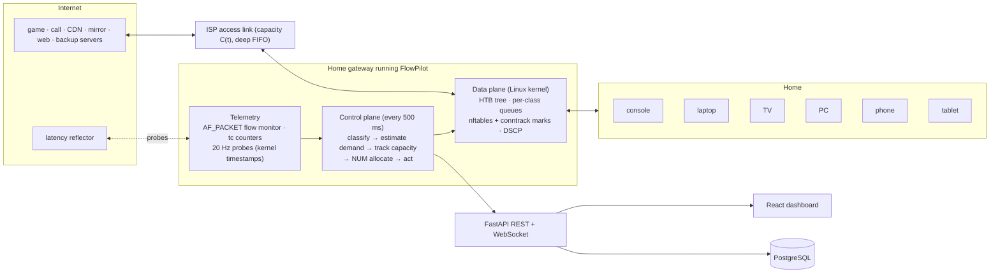

## 1. The problem, precisely

### 1.1 What a household actually experiences

It is 9 pm. A teenager plays CS2 on the console, a parent is on a Teams call on the
laptop, the smart TV streams Netflix in 4K, someone scrolls on a phone — and the desktop
PC starts a 60 GB Steam update. Within two seconds the game "lags", the call freezes and
the voice turns robotic, pages hang. The link is a perfectly ordinary 50/10 Mb/s plan and
nothing is "broken": **the network is simply queueing everyone's packets behind the
download.**

We reproduced this exactly, on real Linux, before writing any QoS code: with a standard
router, the console's ping goes from **0.1 ms idle to 189 ms average / 249 ms max** as soon
as a 4-connection download starts (CUBIC TCP, 250 ms ISP buffer). In the full scenario
{{K_FIFO_EVENING}} (§7.4).

### 1.2 Why it happens: bufferbloat

The access link (DOCSIS, DSL, GPON uplink, 5G FWA) is the narrowest point. Its equipment
has large drop-tail buffers — often hundreds of milliseconds at line rate [1][2]. Loss-based
TCP (CUBIC is the Linux/Windows default) increases its sending rate until a packet is
dropped, i.e. **until that buffer is full**. Every other packet then waits behind it:

$$ \text{queueing delay} = \frac{\text{buffer occupancy}}{\text{link rate}} = \frac{1.56\ \text{MB}}{50\ \text{Mb/s}} = 250\ \text{ms}. $$

Bandwidth is not the problem — **who waits in which queue** is. A game needs ~0.3 Mb/s but
must not wait more than a few ms; a download needs as much as possible but does not care
about 50 ms.

### 1.3 Why existing fixes are not enough

| Approach | What it does well | Where it breaks in a real home |
|---|---|---|
| ISP / router default (drop-tail FIFO) | Nothing to configure | Bufferbloat: hundreds of ms under any upload or download |
| Classic "gaming QoS" (port rules) | Prioritises known game/VoIP ports | Almost everything is encrypted on port 443 (Netflix, Steam, web, backups look identical); fixed shaper rate; port lists go stale |
| SQM fq_codel / CAKE [3][4] | Excellent latency on a *stable* link; per-flow / per-host fairness | (a) The shaper rate is static: when the ISP's capacity drops (evening congestion, FWA radio), the queue moves back into the ISP and latency explodes (we measure 600-1 100 ms at the 99th percentile). (b) It is *application-blind*: fairness is not intent — a call and a backup on the same laptop share equally; a 16-connection download beats a 1-connection 4K stream under per-flow fairness. (c) CAKE is missing from many vendor CPE kernels (and from the kernel of our own testbed VM). (d) No visibility or explanations for the user or the ISP. |
| cake-autorate [5] | Tracks capacity from delay | Fixes (a) only |
| L4S / NQB / Low-Latency DOCSIS [6][7][8] | Sub-ms queueing for marked traffic | Needs end-to-end support and application marking (DSCP 45); most home traffic is unmarked today |

### 1.4 Requirements we derived

| # | Requirement | How we measure it |
|---|---|---|
| R1 | Keep latency-critical apps near their base RTT under any load: game added RTT p95 ≤ 30 ms, call added OWD p95 ≤ 50 ms | p50/p95/p99 latency, % of seconds within SLO |
| R2 | Learn which application each flow belongs to **without DPI** (encrypted, port-agnostic) | classifier accuracy on unseen households and on real-kernel flows |
| R3 | Learn how much each application needs (demand), not just its type | allocation vs demand, streaming bitrate, call video bitrate |
| R4 | Track the link's true capacity as it changes | latency during capacity drops, utilisation |
| R5 | Allocate by *household intent* (gaming / WFH / movie night) while never starving anyone | weights, floors; bulk throughput; Jain / QoE fairness |
| R6 | Explain every decision | plain-language decision log, dashboard, database |
| R7 | Deployable on commodity Linux CPE (RDK-B, OpenWrt, prplOS): no exotic kernel features | data plane uses HTB + FIFO + nftables + conntrack only |
| R8 | Prove it against standard scheduling, on real Linux, reproducibly | same scenarios in a simulator and a real-kernel testbed; scripts reproduce every number |

---

## 2. Research: state of the art and the gap we fill

**Bufferbloat and AQM.** Gettys & Nichols named the problem and showed multi-second
latencies in home connections [1][2]. CoDel (RFC 8289) keeps the *standing* queue near a
5 ms target by dropping at an increasing rate once the minimum sojourn time stays above
target for 100 ms; FQ-CoDel (RFC 8290) adds flow queueing with a sparse-flow boost and is
the Linux default. OpenWrt's SQM wraps it with a shaper set to ~85-95 % of the measured line
rate so that the router, not the modem, becomes the bottleneck [9]. CAKE integrates
shaping, per-host and per-flow fairness, DiffServ tins and ACK filtering into one qdisc [4].

**Capacity tracking.** cake-autorate adjusts CAKE's shaper from one-way-delay deltas to
public reflectors for variable links (LTE, Starlink) [5]: cut on bufferbloat, raise under
load when delay is low. Our heuristic autorate follows the same principle; our RL agent
learns a better control law on top of it.

**Low-latency architectures.** L4S (RFC 9330) and the DualQ Coupled AQM (RFC 9332) give
scalable congestion controls sub-millisecond queues [6][7]; the NQB PHB (RFC 9956, DSCP 45,
May 2026) gives smooth, low-rate traffic a separate shallow queue and requires *traffic
protection* against misuse [8]. FlowPilot marks its real-time class DSCP 45 and implements
traffic protection, so it composes with NQB-aware networks; but it does not *require* end
points to mark anything, because today almost nothing does.

**DiffServ and Wi-Fi.** RFC 4594 defines service classes [10]; RFC 8622 the Lower-Effort
PHB for background traffic [11]; RFC 8325 maps DSCP to Wi-Fi WMM access categories [12].
FlowPilot's five classes follow this taxonomy and write the corresponding DSCP on egress,
so the Wi-Fi hop (often the next bottleneck) honours the same priorities.

**Classifying encrypted traffic.** Port-based classification is obsolete; payload
inspection is impossible under TLS 1.3/QUIC and undesirable for privacy. Surveys show that
flow statistics — packet sizes, inter-arrival times, direction, burstiness — classify
encrypted traffic with >95 % accuracy using classical ML [13][14][15]. We use exactly these
features, computed on the router, and add *early* classification (from 0.5 s) and online
hysteresis.

**Learning-based network control.** Pensieve showed RL can learn better video ABR than
hand-tuned rules [16]; DRL has been applied to SDN QoS and bandwidth allocation [17][18].
Two lessons shape our design: (1) learn where the hand-written controller is weakest
(capacity tracking on variable links), not everything at once; (2) deploy learned
policies inside guarantees — *residual* policies that refine a sound controller [19] and
*shields* that veto unsafe actions [20].

**QoE.** Voice: ITU-T G.107 E-model (R → MOS) [21] with G.114's 150/400 ms one-way delay
planning limits [22]. Gaming: latency below 100 ms already degrades FPS players' accuracy
[23]; G.1072 models gaming QoE. Video: buffering ratio dominates engagement (1 % more
buffering → >3 minutes less viewing per 90-minute event) [24]; P.1203 / QoE_lin combine
bitrate, stalls and switches [16]. Web: G.1030 maps page-load time to MOS logarithmically.
Fairness: Jain's index [25] and the QoE fairness index of Hoßfeld et al. [26].

**Industry context.** Tata Elxsi integrated RDK-B with Qualcomm's 5G FWA platform,
explicitly offering QoS to operators [27]; the Broadband Forum's TR-181 data model and
TR-369 (USP) are how operators manage such gateways [28]. FlowPilot is designed to live in
exactly that stack (§9).

**The gap.** No deployed approach simultaneously (a) keeps latency low, (b) follows a
varying capacity, (c) knows *which application* each flow is and *what it needs*, (d)
allocates by household intent, (e) explains itself, and (f) runs on a plain HTB kernel.

| | low latency | follows capacity | app-aware | intent | explains | plain-HTB kernel |
|---|---|---|---|---|---|---|
| FIFO | | | | | | ✓ |
| Static QoS | partly | | ports only | | | ✓ |
| fq_codel / CAKE | ✓ | | | | | (needs the qdisc) |
| CAKE + autorate | ✓ | ✓ | | | | (needs CAKE) |
| **FlowPilot** | ✓ | ✓ | ✓ (ML) | ✓ | ✓ | ✓ |

---

## 3. FlowPilot at a glance



Every 500 ms the controller closes this loop:

1. **Observe** — per-flow byte counters and behavioural features (router-side flow
   monitor), per-class queue statistics (`tc -s -j`), one-way delays from probes.
2. **Classify** — the ML model labels each flow (gaming, video call, streaming, web, bulk,
   upload) with a confidence; labels change only after two consistent confident votes.
3. **Estimate demand** — per class: offered load, 100 ms burst peaks for real-time media,
   saturation for elastic traffic, learned average bitrate for video streams.
4. **Track capacity** — every 200 ms the autorate (heuristic or RL) sets the shaper just
   below the true bottleneck so the queue stays in the router, where FlowPilot controls it.
5. **Allocate** — network-utility maximisation: inelastic latency-critical traffic first
   (protected but capped), then weighted proportional fairness among elastic classes,
   with floors so nothing starves, and per-device fairness inside "bulk".
6. **Act** — write each flow's class into its conntrack mark and push the HTB plan
   (rates, ceilings, priorities, burst sizes, buffer limits) to the kernel. Log why.

---

## 4. Design in detail

### 4.1 Traffic classes

| Class | HTB id | Applications | Borrow prio | Delay budget | DSCP written | Wi-Fi AC (RFC 8325) | Kind |
|---|---|---|---|---|---|---|---|
| Real-time | 1:10 | game state, DNS, latency probes | 0 | 5 ms | 45 (NQB) | AC_VO | inelastic |
| Conferencing | 1:20 | video calls (Teams/Zoom/Meet) | 1 | 15 ms | AF41 | AC_VI | inelastic |
| Interactive | 1:30 | web, API calls, **new unclassified flows**, pure TCP ACKs | 2 | 15 ms | CS0 | AC_BE | elastic |
| Streaming | 1:40 | buffered video (Netflix/YouTube/Prime) | 3 | 20 ms | AF31 | AC_BE | elastic |
| Bulk | 1:50 → 1:51..1:59 | downloads, updates, cloud backup — one sub-class per device | 4 | 20 ms (+BDP rule) | LE (1) | AC_BK | elastic |

New flows start in *Interactive* (benefit of the doubt, like FQ-CoDel's sparse-flow
boost) unless they **inherit** the class of sibling connections from the same device to
the same server (download managers and browsers open several) — see §4.4.5.

### 4.2 Data plane (what runs in the kernel)

```
r-lan (downlink)                         r-wan (uplink): identical tree
1:   htb default 30
└─ 1:1  rate = ceil = C_hat (autorate)
   ├─ 1:10 Real-time     rate g10  ceil min(R, 2·g10)   prio 0   leaf: short queue
   ├─ 1:20 Conferencing  rate g20  ceil min(R, 2·g20)   prio 1   burst = 40 ms of g20
   ├─ 1:30 Interactive   rate x30  ceil R               prio 2
   ├─ 1:40 Streaming     rate x40  ceil ≤ 2.5·learned bitrate     prio 3
   └─ 1:50 Bulk          rate x50  ceil R               prio 4
      └─ 1:51 … 1:59     one leaf per home device, equal share, ceil R
```

* **HTB semantics** (we model them exactly in the simulator): a class sends at its
  guaranteed `rate`, may *borrow* up to `ceil` when others leave capacity unused; spare
  capacity goes to the lowest `prio` first; within a priority, in proportion to rate.
  So guarantees are not limits — the tree is **work-conserving**: a download still gets
  the whole link when nobody else needs it.
* **Leaf queues:** `fq_codel` when the kernel has it; otherwise a `bfifo` whose byte limit
  FlowPilot rewrites every 500 ms to *drain rate × delay budget* — a time-bounded queue
  that needs no AQM support in the kernel. Our testbed kernel has no fq_codel, so every
  real-kernel result in this report uses the plain-bfifo variant.
* **Classification:** the controller writes the class id into the flow's **conntrack
  mark** (`conntrack -U … --mark 51`); one nftables rule per class copies the mark into
  `skb->priority`, which HTB uses directly as the class id, and rewrites DSCP. Both
  directions of a connection follow automatically. Fixed rules: DNS and probes → 1:10;
  pure TCP ACKs (`tcp flags == ack`, length < 120) → 1:30 so a saturated upload can never
  starve the ACK clock of downloads (a classic home-network failure).
* **Why this matters for deployment (R7):** it uses only HTB, FIFO, nftables and
  conntrack — present in every Linux CPE kernel, including RDK-B and OpenWrt builds and
  the VM kernel we tested on, which has *no* fq_codel, CAKE or netem.

### 4.3 Telemetry

* **Flow monitor** — `AF_PACKET` sockets on both router ports copy 64 bytes per packet
  (IP + transport header). Packets are counted *where they arrive* — downlink on the WAN
  port before the shaper, uplink on the LAN port before the shaper — so the monitor sees
  the *offered* load, including packets the router later drops. It runs in its own
  process (≈ 325 000 packets in 60 s at 50 Mb/s in our runs) and ships per-flow counters
  every 500 ms and feature vectors every second. Payloads are never read.
* **Queue statistics** — `tc -s -j class show`: bytes, drops and backlog per class.
* **Latency probes** — 20 Hz UDP probes from the router's WAN address to a reflector beyond
  the ISP. Both ends use **kernel receive timestamps (SO_TIMESTAMPNS)**, so one-way delays
  in both directions are exact even when the controller's event loop is busy. (An early
  version timestamped in user space and the event-loop jitter looked like "uplink
  bufferbloat" — kernel timestamps removed that artefact, §5.3.)

### 4.4 Learning which applications need bandwidth (R2, R3)

#### 4.4.1 Features: the *shape* of a flow, not its contents

Computed per direction over a 5 s sliding window of 100 ms bins (identical code in the
simulator and on the router):

| Group | Features | Why it separates applications |
|---|---|---|
| Transport | `is_udp`, `log_age_s` | games/calls are UDP; age lets the model use more evidence as it accrues |
| Rate | `log_pps_up/down`, `log_kbps_up/down`, `log_peak_kbps_down` | a game is ~64 pkt/s but only ~150 kb/s; a call is Mb/s both ways; bulk is tens of Mb/s one way |
| Size | `mean/std_size_up/down`, `frac_small_up`, `frac_large_up/down`, `frac_small_down` | game packets are small; video frames are ~1200 B; downloads are 1500 B down and 66 B ACKs up; uploads the reverse |
| Timing | `iat_cv_up/down`, `log_iat_mean_up/down_ms` | ticks and media frames are periodic (low CV); TCP is bursty |
| Burstiness | `burst_cv_up/down`, `on_frac_up/down` | video streaming is ON/OFF (segment fetch, then idle); bulk is continuous |
| Asymmetry | `log_ratio_up_down` | calls are symmetric, streaming/bulk downlink-heavy, backups uplink-heavy |
| Context | `log_host_flows`, `log_host_same_dst` | download managers open many parallel connections to one server |

Port numbers are deliberately **not** features: everything interesting runs on 443.

#### 4.4.2 Data: 400 randomised households

`python -m flowpilot.ml.dataset` simulates 400 households, each with a random link
(8-300 Mb/s, asymmetric ratios, 30-600 ms ISP buffers, 2-90 ms path delays), a random
router (FIFO with bufferbloat, fq_codel, static QoS, CAKE) and 3-9 randomised
applications: game tick rates 20-128 Hz and packet sizes, call bitrates and frame rates,
streaming ladders/segment lengths/buffer targets, 1-16 parallel connections, think times.
Features are sampled at flow ages 0.5 s … 60 s. Result: **122 664 labelled samples**
(gaming 3 990, video call 4 093, streaming 4 212, web 64 409, bulk 24 721, upload 21 239).
Randomising the generators (domain randomisation) is what makes the model transfer to
traffic it never saw — including real Linux TCP (§4.4.4).

#### 4.4.3 Model

A histogram gradient-boosted tree ensemble (scikit-learn `HistGradientBoostingClassifier`,
48 leaves, early stopping, class re-weighting). It needs no feature scaling, handles the
non-linear interactions (e.g. "UDP **and** small **and** periodic"), trains in ~11 s and
classifies 64 flows in ~6 ms on one core. Training uses a **grouped split: whole households
are held out**, so the score measures generalisation to unseen homes.

#### 4.4.4 Results


| Model | Accuracy (unseen households) | Macro-F1 |
|---|---|---|
| **Gradient-boosted trees (deployed)** | **99.66 %** | **0.993** |
| Random forest (200 trees) | 99.40 % | 0.989 |
| Expert rules (fallback) | 74.3 % | 0.719 |

* Per class: gaming, video call and upload are perfect (F1 = 1.000); web 0.998, bulk 0.992;
  streaming 0.971 — the only real confusion is a video player *filling its buffer*, which
  for a few seconds looks exactly like a download.
* **Early classification:** 99.6 % accuracy already for flows younger than 1 s.
* **Most informative features** (permutation importance): fraction of large uplink packets,
  fraction of small uplink packets, parallel connections to the same server, uplink
  inter-arrival regularity, transport protocol.
* **Sim-to-real transfer:** trained *only* on simulated traffic, the model labelled the
  flows of the real Linux testbed — real kernel CUBIC, real sockets, real timing —
  {{K_ACC_SENTENCE}} (§7.7).

#### 4.4.5 Making it robust online

* **Hysteresis** — a flow's label changes only after two consecutive predictions agree with
  ≥ 60 % confidence; the first label needs ≥ 55 %.
* **Sibling inheritance** — a new connection from a device to a server it is already
  talking to starts in the siblings' class (e.g. the 8 Steam connections, a browser's 6
  connections), instead of spending its first second in *Interactive*.
* **Traffic protection** (RFC 9956 spirit) — a flow in Real-time that exceeds 1.5 Mb/s, or
  in Conferencing beyond 12 Mb/s, for 3 control periods is moved to Bulk and the event is
  logged. A misclassified QUIC download cannot hijack the priority classes.
* **Explanations** — each decision carries a human-readable reason, e.g. *"steady 64/64
  pkt/s of small packets (98/326 B), only 210 kb/s: a game-state exchange"*.

#### 4.4.6 Learning *how much* each application needs

* **Inelastic (game, call):** guarantee = 1.3 × max(peak 0.5 s load, 0.6 × 100 ms burst
  peak) + 64 kb/s per flow, capped (Real-time ≤ 20 %, Conferencing ≤ 45 %, both ≤ 55 % of the
  link). Sizing on *100 ms* peaks matters: HTB serves classes within their guarantee before
  any borrowing class, so a video key-frame that exceeds the guarantee would otherwise wait
  behind bulk traffic. An HTB `burst` of 40 ms lets a whole key-frame leave at line rate.
* **Elastic:** a class is *saturated* if, in the last 4 s, it used ≥ 85 % of its allocation,
  queued beyond 30 % of its buffer, or dropped; then its demand is unbounded, otherwise
  1.25 × its peak.
* **Streaming:** each stream's ~20 s average rate approximates its bitrate; FlowPilot caps
  the class's burst ceiling at ≈ 2.5 × that (≥ 4 Mb/s) so a segment fetch cannot starve
  everyone else, yet the player can still step up one rung.
* **Device profiles:** every 5 s the observed (device, application, demand) is folded into
  `device_profiles` in PostgreSQL (EWMA averages and peaks) — the household's learned
  "who uses what" history shown in the dashboard.

### 4.5 Allocation as network-utility maximisation (R5)

For one direction with shaped capacity $R$ we choose class guarantees $x_k$:

$$ \max_{x}\ \sum_{k\in\text{inelastic}} w_k\,\mathbb{1}[x_k \ge d_k] \;+\; \sum_{k\in\text{elastic}} w_k \log x_k
\quad\text{s.t.}\quad \sum_k x_k \le R,\;\; f_k \le x_k \le c_k . $$

Inelastic utility is a step at the demand $d_k$ (bandwidth below it is worthless, above it
useless) [29]; elastic utility is logarithmic, whose optimum is the weighted
proportionally fair allocation [30]. With demand caps the solution is:

1. **Inelastic first:** $x_k = \min(c_k,\ d_k)$ (scaled down together if they exceed 55 % of $R$
   — logged as an admission warning).
2. **Weighted water-filling** for elastic classes on what remains,
   $x_k = \min\big(d_k,\ \max(f_k,\ w_k\lambda)\big)$ with $\lambda$ such that $\sum x_k = R_{el}$.

Floors $f_k$ (Bulk ≥ 5 %, Interactive ≥ 5 %) guarantee no starvation. Weights come from
the household **intent**:

| intent | Real-time | Conferencing | Interactive | Streaming | Bulk |
|---|---|---|---|---|---|
| balanced (default) | 8 | 8 | 4 | 4 | 1 |
| gaming | 12 | 6 | 4 | 3 | 1 |
| work_from_home | 6 | 12 | 6 | 2 | 1 |
| movie_night | 6 | 6 | 3 | 8 | 1 |

Mapping to HTB: `rate = x_k`; `ceil = R` for elastic classes (work-conserving), `ceil =
min(R, max(2 g, g + 2 Mb/s))` for inelastic ones (traffic protection); fixed borrowing
priorities (§4.1). **Buffer sizing:** classes that drain at up to their ceiling (web,
streaming) get `ceil × budget`; each device's bulk leaf gets
$\max(\text{budget},\ \text{RTT}/\sqrt{n})$ of its share, $n$ = that device's parallel
flows — the classic $BDP/\sqrt{n}$ rule [31] that lets even a *single* download connection
keep its fair share (without it, a 1-connection tablet lost to a 16-connection PC: Jain 0.92
→ 0.98 after the fix).

### 4.6 Tracking the link's capacity (R4)

Ingress (download) shaping only works if the router's shaper is slower than the true
bottleneck; if the ISP's capacity drops below the shaper, the queue silently moves back
into the ISP's deep buffer. FlowPilot's autorate (every 200 ms, per direction):

* **Signal:** one-way delay samples $o_t$; baseline $b \leftarrow b + 0.9(o-b)$ when $o<b$,
  else $b \leftarrow b + 0.001(o-b)$ (fast down, slow up); delta $\delta = o-b$, EWMA 0.3.
* **Bufferbloat** = at least 3 of the last 6 deltas above 12 ms (or probes lost for > 1 s
  under load) → cut: $R \leftarrow \max\big(R_{min},\ \min(R, a)\cdot\max(0.75,\ 0.97 - (\delta-12)/150)\big)$,
  with $a$ the throughput actually delivered — a deeper cut for a worse bloat — then a
  600 ms refractory period.
* **Probe up** when load ≥ 80 % and $\delta$ < 6 ms: ×1.04 per step, but only ×1.003 near the
  last bloat point during the first 3 s after a bloat, ×1.012 until 8 s, then full speed —
  concave-then-convex like CUBIC, so a ceiling is not hammered yet recovered capacity is
  found within seconds. (A first version without the time-decay took > 15 s to recover from
  a capacity dip; fixing it raised utilisation in the congestion scenario from 75 % to 87 %.)
* **Ceiling:** 95 % of the plan rate for fixed lines — the SQM margin [9].

### 4.7 Reinforcement learning for capacity tracking

The heuristic's constants (thresholds, step sizes) are a compromise across link types. RL
learns a state-dependent control law. We formulate:

* **State (12 features, all router-observable):** delay delta, max delta in the last
  interval, delta trend, shaper load, rate / plan, delivered rate / plan, last action, time
  since the last bloat, fraction of samples over threshold, last bloat rate / plan,
  throughput-change ratio, and the heuristic's proposed change.
* **Action — residual policy [19]:** multiply the heuristic's proposed rate by one of
  {0.80, 0.90, **1.00**, 1.05, 1.12}. "1.00" *is* the heuristic, so the agent starts from,
  and can only refine, a sound controller.
* **Reward per 200 ms:** $r = u - 0.04\,(d-5)^+ - 0.0015\,(d-30)^{+2} - 0.3\,\text{loss} - 0.01\,\text{change}$,
  clipped at −10, with $u$ the utilisation of the true capacity and $d$ the ISP queueing
  delay in ms.
* **Shield [20]:** never amplify an increase while bloated (δ > 15 ms) or idle (load < 0.3).
* **Training environment:** a vectorised **fluid model** of the access link at 10 ms
  resolution (`ml/rl/fluid.py`): capacity traces from three families (fixed line with
  congestion steps; 5G-FWA-like AR(1) log-capacity with deep fades; LTE-like regime
  switching), TCP aggregate chasing min(R, C) with overshoot and multiplicative back-off on
  buffer overflow, random burst arrivals (slow starts, segment fetches), inelastic load,
  buffer depth 80-800 ms, probe noise 0.2-3 ms. 32 environments in parallel; ~1 M
  transitions train in ~6 minutes on a laptop CPU.
* **Learner:** Double DQN, numpy MLP 12-64-64-5 (no deep-learning framework needed on a
  router), Huber loss, Adam (5e-4), replay 300 k, batch 256, soft target updates (τ =
  0.005), γ = 0.95 (≈ 4 s horizon), ε 1 → 0.03.

Results are in §7.8. A first attempt with direct multiplicative actions (no residual), and
a second with an extra "snap to delivered rate" action, were both worse than or unstable
against the heuristic; the residual formulation fixed that — a useful lesson we keep in
the report.

### 4.8 Explainability (R6)

Every action is logged with its reason; examples from real runs:

```
 1.53 classify  console: UDP flow to 203.0.113.10:27015 is Online gaming (100%) -> Real-time
10.95 classify  laptop: UDP flow to 203.0.113.11:3478 is Video call (100%) -> Conferencing
14.71 allocate  Downlink 43.3 Mb/s guaranteed: Real-time 0.4, Conferencing 4.7, Interactive 9.2,
                Streaming 21.7, Bulk 7.4 Mb/s
20.85 autorate  Bufferbloat on the downlink (+21 ms): ISP capacity fell, shaper 47.5 -> 41.3 Mb/s
33.56 classify  pc: TCP flow to 203.0.113.13:443 is Bulk download (100%) -> Bulk
```

The log streams to the dashboard and is stored in the `decisions` table.

### 4.9 Guard-rails

No class can starve (floors); inelastic classes are capped (traffic protection); labels
change only with hysteresis; the RL agent is residual + shielded and falls back to the
heuristic on out-of-range observations; the bfifo limits are rewritten only on >10 %
changes; if no trained model exists, a transparent rule set classifies (74 % accurate) and
the controller still works.

---

## 5. Implementation

### 5.1 Stack and module map

| Concern | Technology | Where |
|---|---|---|
| Digital twin | Python discrete-event simulator (≈ 400 k events/s) | `backend/flowpilot/sim` |
| Real network | Linux network namespaces, veth, bridge, TUN, HTB, TBF, bfifo, nftables, conntrack, AF_PACKET | `backend/flowpilot/testbed` |
| Controller | Python (shared by both back-ends) | `backend/flowpilot/controller` |
| ML / RL | scikit-learn, numpy | `backend/flowpilot/ml` |
| API | FastAPI, uvicorn, WebSocket | `backend/flowpilot/api` |
| Storage | PostgreSQL 16 via SQLAlchemy 2 (SQLite fallback) | `backend/flowpilot/db` |
| Dashboard | React 18, TypeScript, Vite, Recharts | `frontend/` |
| Packaging | Dockerfile, docker-compose (PostgreSQL + API, optional privileged testbed) | repo root |

The **same controller code** drives the simulator and the kernel: only two adapters differ
(`controller/sim_qos.py` and `testbed/kernel_qos.py`), and the same feature code runs in the
simulator and in the router's packet monitor.

### 5.2 The digital twin

* Event engine with a binary heap; links serialise packets at their rate and hand them to a
  pluggable qdisc.
* **TCP:** CUBIC with HyStart, slow-start restart after idle, delayed ACKs, SACK-style loss
  recovery (DupThresh 3), RFC 6298 RTO with back-off; ACKs travel through the *same*
  uplink queues — which is what makes uploads hurt downloads.
* **Qdisc models:** FIFO; FQ-CoDel per RFC 8290 (DRR++ with new/old lists, CoDel control
  law, drop-from-fattest); CAKE-style host fairness (quantum ÷ host load, as in sch_cake);
  HTB with Linux semantics (modes, lender levels, prio, DRR quantum = rate/r2q, charging
  rules) — unit-tested (`tests/test_qdisc_sim.py`).
* **Applications:** game (tick-rate UDP, in-game ping with server hold-time compensation),
  video call (audio 50 pkt/s + paced video frames with key-frames, receiver reports, GCC-like
  delay/loss rate control), streaming (Netflix-like 235 kb/s - 16 Mb/s ladder, 4 s
  segments, 30 s buffer, throughput + buffer ABR, real stalls), web (DNS-less page = TCP +
  TLS handshakes, main document, 8-30 objects over up to 6 connections), bulk download and
  upload (N parallel CUBIC flows).

### 5.3 The real-kernel Linux testbed

```
fp-inet  servers 203.0.113.10-15 + reflector .53
   │  TUN ⇄ userspace delay line (per-server one-way delay, e.g. 14.5 ms to the game server)
fp-isp   TBF 50 Mb/s down + 250 ms FIFO; TBF 10 Mb/s up + 500 ms FIFO   (the "ISP")
   │  veth
fp-router  FlowPilot / baseline qdiscs on r-lan (down) and r-wan (up), nftables, conntrack,
   │       AF_PACKET monitor, probes
fp-lan   bridge br0
   ├─ fp-dev-console 192.168.1.10   ├─ fp-dev-laptop .11   ├─ fp-dev-tv .12
   ├─ fp-dev-pc .13                 ├─ fp-dev-phone .14    └─ fp-dev-tablet .15
```

* All traffic is **real**: kernel TCP (CUBIC) and UDP sockets created inside each device's
  namespace by one asyncio process (a socket stays bound to the namespace it was created in,
  so `setns` → create → switch back), real HTB/TBF queues, real nftables and conntrack.
* **Delay line instead of netem:** the testbed VM's kernel has no `netem` (nor `fq_codel`,
  `cake`, `prio`, `sfq`). We join the Internet and ISP namespaces with two TUN devices and
  a relay process that delays each packet by its server's one-way path delay — real RTTs
  (31 ms console↔game server, 15 ms TV↔CDN) for every TCP connection.
* GSO/TSO/GRO are disabled on every veth so frames are 1500-byte packets, as on a real
  access link; CUBIC is selected in every namespace (the VM default, BBR, would hide
  bufferbloat — itself a finding worth noting: BBR-paced CDNs bloat less).
* **Kernel timestamps** (SO_TIMESTAMPNS) for every latency measurement.
* `testbed/netns.py::capabilities()` probes which qdiscs the kernel offers; schedulers that
  need missing qdiscs (fq_codel, CAKE) are skipped automatically on the kernel testbed and
  evaluated in the digital twin instead.

### 5.4 API and database

REST: `/api/capabilities`, `/api/session/start|stop|action`, `/api/runs…`,
`/api/benchmarks…`, `/api/models/classifier|rl`, `/api/profiles`; WebSocket `/ws/live`
streams one JSON tick per second (per-app metrics, per-class allocation, flow table,
decisions). Tables: `runs`, `samples` (per-second telemetry, JSONB), `decisions`, `flows`,
`device_profiles`. A background writer thread batches inserts so the control loop never
waits on the database. Benchmark result files are imported automatically on start-up.

### 5.5 Dashboard


The **Live** tab runs an A/B session: the same simulated household under two routers
(default: standard FIFO vs FlowPilot), with one-click events (Steam update, photo backup,
OneDrive sync on the call laptop, 16-connection download, second 4K stream, ISP
congestion, restore) and household intents. It shows per-app KPIs and QoE colours, latency
and throughput charts, the per-class allocation, the classified flow table with confidence
and explanation, and the AI decision feed. In **Linux testbed** mode the same page drives
the real kernel. Other tabs: **Benchmarks** (all results from PostgreSQL, digital twin or
real kernel), **AI models** (classifier card, RL training/evaluation), **History** (stored
runs, learned device profiles), **How it works**.


*The Benchmarks tab: every router on the same scenario, from the database (here: the real
Linux kernel results).*


*The AI models tab: the classifier's model card — accuracy on unseen homes, confusion matrix,
where it still errs, accuracy by flow age; the RL autorate's evaluation follows below.*

| History: stored runs and learned device profiles | How it works: architecture and design notes |
|---|---|
|  |  |

### 5.6 Tests

`python -m pytest -q` (15 tests): E-model reference points and fairness formulas, allocator
invariants (protection, floors, caps, work conservation), HTB rate/ceil/priority-borrowing
semantics, FQ-CoDel sparse-flow isolation, bufferbloat reproduced by FIFO and removed by
FlowPilot, trained-model recognition of simulated apps, rule fallback, a full live API
session over the WebSocket, and testbed connectivity (as root).

---

## 6. Evaluation methodology

**Questions.** Does FlowPilot (Q1) cut latency and loss for critical apps versus standard
scheduling, (Q2) stay correct when capacity changes, (Q3) improve fairness and QoE rather
than just move pain to someone else, (Q4) work on a real kernel, and (Q5) what does it cost?

**Two testbeds, same scenarios, same metric code.**

1. *Digital twin* (simulator): all eight router policies, three seeds per cell.
2. *Real Linux kernel testbed*: the policies whose qdiscs this kernel offers — FIFO,
   static QoS, FlowPilot, FlowPilot + RL (fq_codel and CAKE are absent here; on a stock
   Ubuntu/OpenWrt kernel they run on the testbed too).

**Scenarios** (household of six devices; 50/10 Mb/s unless stated; ISP buffers 250 ms down /
500 ms up at plan rate):

| Scenario | What happens | Tests |
|---|---|---|
| Evening rush | game + Teams call + 4K Netflix + web; t = 20 s Steam update (8 TCP) | Q1, classic bufferbloat |
| Upload storm | game + call + web; t = 15 s tablet photo backup (4 uploads); t = 30 s download | uplink bloat, ACK starvation |
| Work-from-home sync | the laptop on the call also syncs OneDrive (4 uploads) | same-device contention (per-host fairness cannot help) |
| ISP congestion | evening rush; capacity 50/10 → 22/6 Mb/s from 45 s to 85 s | Q2, fixed shapers |
| Download hog | 16-connection download vs 1-connection download + call + 4K stream | Q3, fairness |
| 5G FWA fading | capacity follows an AR(1) trace 15-60 Mb/s with deep fades | Q2, variable links |

**Router policies (baselines).**

| Policy | Represents |
|---|---|
| Standard router (FIFO) | most ISP CPE: no shaping, drop-tail |
| Static QoS | consumer "gaming QoS": HTB at 95 % of the plan, port rules (Xbox, Steam, Teams/STUN, Zoom, Meet, SIP, DNS), ACK priority |
| SQM fq_codel | OpenWrt SQM `simplest.qos` at 95 % of plan |
| SQM CAKE | CAKE-style per-host + per-flow fairness with CoDel at 95 % of plan |
| CAKE + autorate | CAKE with the same delay-based autorate FlowPilot uses (the strongest open-source competitor) |
| **FlowPilot** | this work; bfifo leaves (works on any kernel) |
| FlowPilot + fq leaves | FlowPilot with fq_codel leaves (when the kernel has it) |
| FlowPilot + RL | FlowPilot with the residual-DQN autorate |

**Metrics** (`backend/flowpilot/common/metrics.py`).

* Latency: game in-game RTT (server hold-time compensated), call one-way delay (both
  directions, worst reported); p50/p95/p99 over all samples; jitter (RFC 3550).
* Loss per stream from sequence numbers; **late frames** of the call: share of video frames
  that are incomplete or complete more than 250 ms after capture (seen as a freeze).
* Voice MOS: E-model, $R = 93.2 - I_d - I_{e,eff}$, mouth-to-ear = median OWD + adaptive
  jitter buffer (max(20 ms, 2.5 × jitter)) + 25 ms codec; late packets count as lost;
  penalised by video freeze rate.
* Gaming MOS: 5 at ≤ 40 ms RTT p95 → 1 at ≥ 250 ms, minus jitter and loss penalties.
* Streaming MOS: logarithmic bitrate utility minus stall-ratio and stall-count penalties
  (P.1203 structure); also average bitrate, rebuffer ratio, QoE_lin.
* Web MOS: $5 - 1.4 \ln(\text{PLT}/0.5\,\text{s})$ (G.1030-style).
* **Interactive MOS** = mean over game, call, video and web (what people actively
  perceive); bulk transfers are reported as throughput.
* Fairness: Jain's index across the downloading devices; QoE fairness $F = 1 - 2\sigma/(H-L)$.
* Utilisation: delivered / capacity while a bulk transfer is active.
* SLO compliance: share of the game's and the call's 1 s intervals that meet their SLO —
  game added-RTT p95 ≤ 30 ms and loss ≤ 1 %; call added one-way delay p95 ≤ 50 ms and loss
  ≤ 2 %. *Added* = measured minus the base path delay to that server, which is the same in
  both testbeds.

**Protocol.** Simulator: 6 scenarios × 8 policies × 3 seeds = 144 runs (mean shown, min-max
in the data files). Kernel: 6 scenarios × 4 policies × 2 runs = 48 runs in wall-clock real
time (mean shown).
